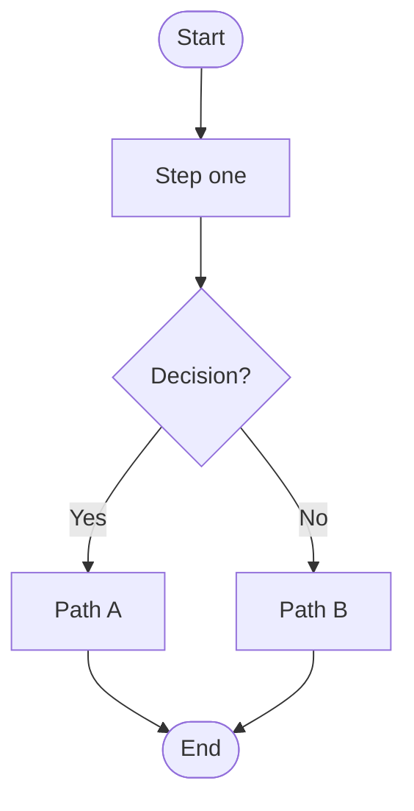
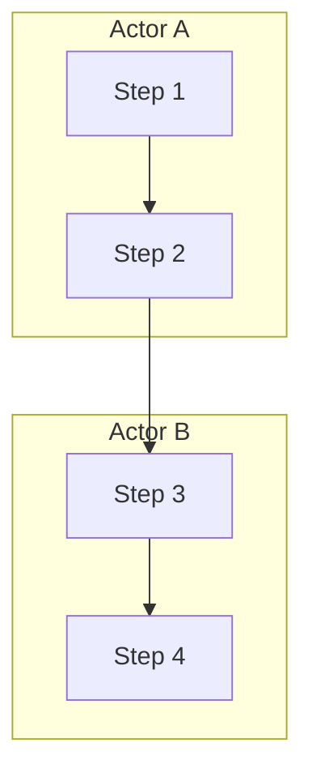
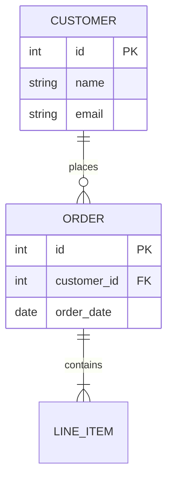
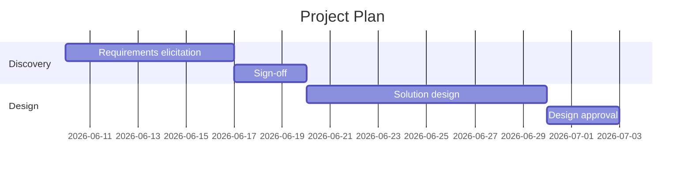
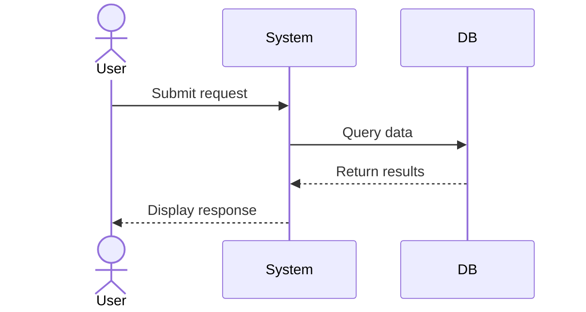
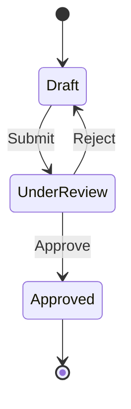

# Skill: create-diagram

## Purpose
Generate flowcharts, process maps, architecture diagrams (including C4 model),
ERDs, Gantt charts, swimlane diagrams, and other visual artifacts using Mermaid —
the format that renders natively in GitHub, VS Code, Notion, and most documentation
platforms. PDF export via `ai-sa-employee/document-skills/pdf` (✅ ready — Poppler installed).

## Trigger
Invoke when the operator says "create a diagram", "draw a flowchart", "map this
as a diagram", "show me the process visually", "generate an ERD", "draw the
architecture", "create a swimlane", "Gantt chart", or "visualise this".

## Minimum context required
- What to diagram (process, system, data model, timeline, interaction)
- Client / project (to read context and save to the right file)
If missing: ask what to visualise and which project it relates to.

---

## Diagram type routing

| Operator says / context | Diagram type | Mermaid syntax |
|---|---|---|
| Process flow, workflow, "how does X work" | Flowchart | `flowchart TD` / `flowchart LR` |
| AS-IS / TO-BE process | Two flowcharts (before + after) | `flowchart TD` × 2 |
| Cross-functional / roles + steps | Swimlane | `flowchart TD` with `subgraph` per actor |
| System context, what the system is + who uses it | C4 Context diagram | `flowchart LR` — system in centre, users + external systems around it |
| System containers, tech stack, major parts | C4 Container diagram | `flowchart LR` with `subgraph` per container + tech label |
| System components, architecture, integrations | Architecture / component map | `flowchart LR` with `subgraph` per layer |
| Database schema, tables, relationships | Entity-relationship diagram | `erDiagram` |
| Project timeline, milestones, phases | Gantt chart | `gantt` |
| Actor interactions, API calls, message flows | Sequence diagram | `sequenceDiagram` |
| Status transitions, lifecycle states | State diagram | `stateDiagram-v2` |
| Decision logic, conditional paths | Decision tree | `flowchart TD` with diamond nodes |
| Hierarchical relationships, org chart | Hierarchy / tree | `graph TD` |

---

## Steps

1. Read `memory/memory.md` and `memory/clients/[client-name].md` — domain
   glossary, actor names, system names, known constraints.
2. Read the relevant project file (e.g. `requirements.md` for requirement flows,
   `stakeholders.md` for actor diagrams, `database.md` for ERDs, `plan.md` for
   Gantt) to ground the diagram in confirmed facts.
3. Select the correct diagram type from the routing table above.
4. Draft the Mermaid code. Use names from project files — no invented labels.
5. Output the diagram with a plain-English description of what it shows and why
   it was structured this way.
6. Confirm before writing to a project file.
7. If a PDF export is requested: chain to `ai-sa-employee/document-skills/pdf`.

---

## Output format

````
DIAGRAM: [Title]
Type: [Mermaid type]
Client: [name] | Project: [name] | Date: [YYYY-MM-DD]
---
Description: [1–2 sentences — what this diagram shows and what decision or
deliverable it supports]

```mermaid
[diagram code here]
```

Saved to: [project file where this will be embedded — or "standalone file"]
PDF export: [done via ai-sa-employee/document-skills/pdf — or "not requested"]
````

---

## Mermaid templates (ready-to-adapt)

### Flowchart (process / architecture)


### Swimlane (cross-functional)


### ERD (database schema)


### Gantt (project timeline)


### Sequence (actor interactions)


### State diagram (lifecycle)


---

## Where diagrams live

> Paths below are relative to the **project's own deliverables folder**:
> `memory/clients/[client]/[project]/deliverables/` (gitignored, backed up, co-located with the
> project). Use the repo-root `deliverables/` only for ad-hoc diagrams with no client/project.

| Diagram type | When embedded | When standalone (sent to client) |
|---|---|---|
| Process flow (AS-IS/TO-BE) | `requirements.md` (quick reference) | `deliverables/diagrams/[YYYY-MM-DD]-process-flow.md` |
| Architecture / component | `decisions.md` alongside the ADR | `deliverables/diagrams/[YYYY-MM-DD]-architecture.md` |
| ERD | `database.md` | `deliverables/diagrams/[YYYY-MM-DD]-erd.md` |
| Gantt | `plan.md` | `deliverables/diagrams/[YYYY-MM-DD]-gantt.md` |
| Stakeholder / swimlane | `stakeholders.md` | `deliverables/diagrams/[YYYY-MM-DD]-stakeholders.md` |
| Sequence / state / decision | Not embedded | `deliverables/diagrams/[YYYY-MM-DD]-[type].md` |

**Rule:** diagrams referenced in your own working analysis stay embedded in the relevant project file.
Diagrams prepared for a client or included in a formal document go to `deliverables/diagrams/`.
PDF export of any diagram: chain to `ai-sa-employee/document-skills/pdf` → saves to `deliverables/pdf/`.

---

## Quality checklist

- [ ] Is the diagram type the best fit for what needs to be communicated?
- [ ] Are all labels taken from project files — no invented names?
- [ ] Is the diagram simple enough to read without explanation?
  (If it needs more than 2 sentences to explain, split it into two diagrams)
- [ ] Does the plain-English description state what decision or deliverable this supports?
- [ ] Is the Mermaid code syntactically correct (no unclosed brackets, valid arrows)?
- [ ] Is the save location confirmed before writing?

## Failure exit
"Cannot create a diagram without knowing what to visualise and which project it
relates to. Describe what you want to show and I'll select the right diagram type."
