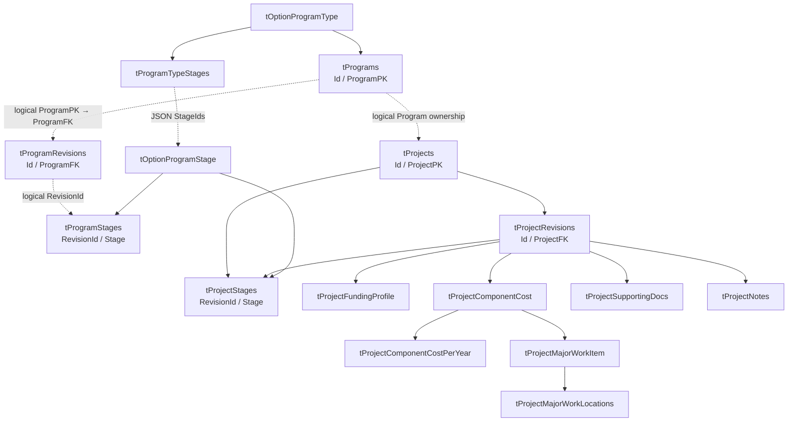
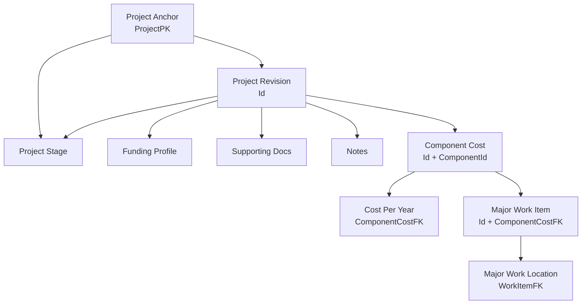
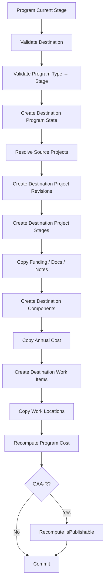
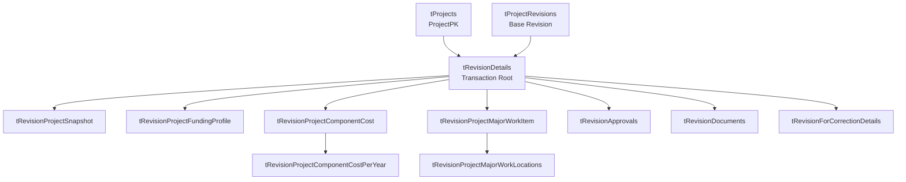
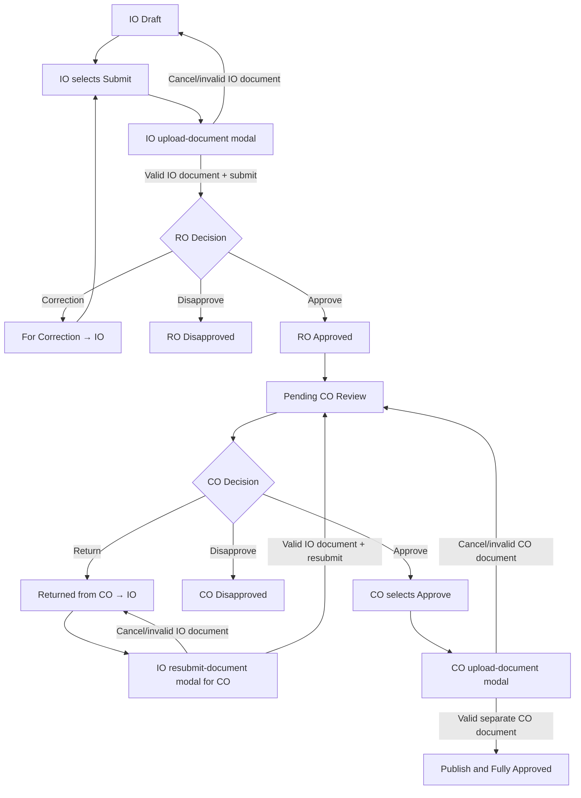
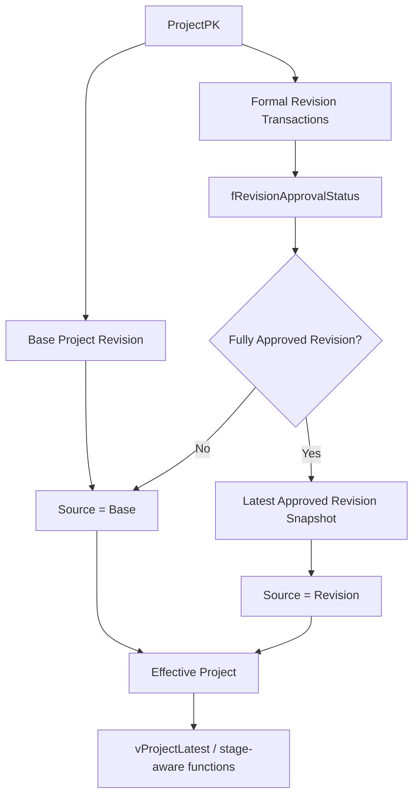
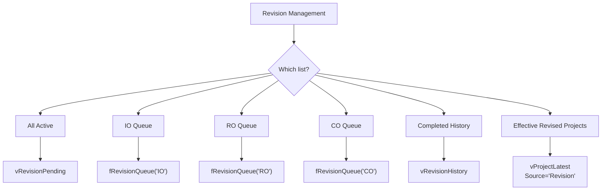

# MYPS_CODEX_MASTER_CONTEXT.md

# MYPS Master Context for Codex

**System:** MYPS  
**Database:** `myps_db`  
**Primary database reference:** `myps_db(08-10-2026-full-schema).sql`  
**Schema reference date:** 10 August 2026  
**Purpose:** Authoritative MYPS-only technical and domain context for Codex and other coding agents working on the MYPS codebase.

## Current testing authority — 2026-08-12

For the current backend snapshot, fresh method lines, test status, defects, and release gates, use:

```text
docs/testing/README.md
docs/testing/CURRENT-SNAPSHOT.md
docs/testing/traceability-matrix.csv
docs/testing/defect-register.csv
```

The testing snapshot is `BE-Michael` at commit `07d4f07ced36173ab6bebf07afd0ac745093a2d9` plus its recorded dirty-tree fingerprint. Three .NET 8 test projects now exist. Their initial execution is `BLOCKED` by LocalDB identity access, Hangfire storage initialization in the test host, incomplete critical conformance coverage, and unresolved Formal Revision schema authority. Do not repeat the older conclusion that no test project exists. (`CODE-CONFIRMED` / `CONFLICT`)

Line numbers in this master context may be stale. Use file + class + function + commit + dirty fingerprint, then regenerate fresh lines with `docs/testing/scripts/refresh-current-snapshot.ps1`.

---

# 1. Document Scope

This document contains only information relevant to MYPS.

It covers:

- MYPS Program architecture
- MYPS Project architecture
- Program/Project identity
- Program and Project lifecycle stages
- Program Type/Stage validation
- Program revision/state handling
- Project revision/state handling
- Project Funding
- Project Component Costs
- Component Costs Per Year
- Major Work Items
- Major Work Locations
- Supporting Documents
- Notes
- LS/wallet-related MYPS fields
- Program cost computation
- GAA-R publication readiness
- PCMA publication
- formal post-publication Project Revision
- IO/RO/CO Revision workflow
- Revision queues
- Revision history
- effective approved Revision overlays
- MYPS security/visibility objects
- current MYPS read models
- important MYPS stored procedures/functions/views
- physical and logical MYPS relationships
- known MYPS schema/application risks
- MYPS-specific Codex guardrails
- MYPS-specific testing requirements

This document intentionally excludes generic:

- ASP.NET Core documentation
- Entity Framework tutorials
- React documentation
- SQL Server tutorials
- authentication tutorials
- unrelated application systems
- unrelated database schemas
- speculative external PCMA behavior
- generic software architecture guidance

---

# 2. Evidence Classification

Codex should interpret statements in this document using these categories.

## DB-VERIFIED

The information was verified against:

```text
myps_db(08-10-2026-full-schema).sql
```

This is the strongest source in this document.

---

## APP-SNAPSHOT

The behavior was observed during inspection of the MYPS application source.

The current database is newer than some portions of the application architecture.

If APP-SNAPSHOT behavior conflicts with the current database schema:

```text
CURRENT DATABASE SCHEMA WINS
```

unless the working source clearly contains a newer migration not represented in the supplied database schema.

---

## DOMAIN-INVARIANT

A rule derived from the way the MYPS database and application operate together.

Examples:

```text
Program owns lifecycle progression.

Historical stages must not be accidentally destroyed.

Destination child records must point to destination parent records.
```

---

## LEGACY

A concept that appeared in earlier MYPS implementations/documentation but is not part of the current August 10 schema.

Codex must not reintroduce LEGACY behavior without explicit instruction.

---

# 3. Source-of-Truth Priority

When MYPS sources disagree, use this order:

```text
1. Current production/working database schema
2. August 10, 2026 myps_db full schema
3. Current SQL procedures/functions/views
4. Current executable application code
5. Current EF models
6. Current frontend workflow
7. Existing MYPS documentation
8. Legacy MYPS documentation/comments
```

Never silently resolve a conflict.

If a conflict affects behavior, Codex should explicitly state:

```text
DATABASE EXPECTS:
...

APPLICATION CURRENTLY DOES:
...

RISK:
...

PROPOSED RESOLUTION:
...
```

before making a structural change.

---

# 4. Critical Legacy Concepts to Avoid

The following are especially important.

## LEGACY: `ReferenceId`

Older MYPS documentation used:

```text
ReferenceId
```

as the persistent Project identity.

The current schema uses:

```text
tProjects.ProjectPK
```

as the stable Project identity.

Codex should use:

```text
ProjectPK
```

for cross-stage identity.

Do not introduce new code based on `ReferenceId` unless the actual current working schema explicitly contains it.

---

## LEGACY: `RevisionNumber`

Older MYPS implementations used stage-scoped revision numbers.

The current August 10 schema definitions for:

```text
tProgramRevisions
tProjectRevisions
```

do not contain:

```text
RevisionNumber
```

Therefore do not build new MYPS logic around:

```text
RevisionNumber
MAX(RevisionNumber)
RevisionNumber + 1
reset RevisionNumber to 1
```

unless a later schema explicitly restores that field.

Current version identity is primarily represented through:

```text
revision row Id
+
stage association
+
stable ProgramPK / ProjectPK
```

---

## LEGACY: Project child ownership through textual Project ID

The current Project child graph is normalized around generated FK identities.

Do not restore relationships where child records are linked only using:

```text
ProjectId
ComponentId
```

when a proper parent FK exists.

---

## LEGACY: revision-level `IsPublishable`

Current schema stores:

```text
tProjects.IsPublishable
```

not:

```text
tProjectRevisions.IsPublishable
```

Treat the Project anchor flag as the current authoritative location.

---

# 5. MYPS Core Concept

MYPS is fundamentally a:

> Program-controlled Project lifecycle, budgeting, publication, and formal Revision system.

High-level domain:

```text
PROGRAM
│
├── Program mutable state
├── Program lifecycle stage
│
└── PROJECT PORTFOLIO
    │
    ├── Project mutable state
    ├── Project lifecycle stage
    │
    ├── Funding
    │
    ├── Component Costs
    │   ├── Annual Costs
    │   └── Major Work
    │       └── Locations
    │
    ├── Supporting Documents
    └── Notes
```

After publication:

```text
PUBLISHED PROJECT
       │
       ▼
FORMAL REVISION
       │
       ├── Revision snapshot
       ├── Revision funding
       ├── Revision components
       ├── Revision annual costs
       ├── Revision work items
       ├── Revision locations
       ├── Revision documents
       ├── correction history
       └── IO / RO / CO workflow
```

---

# 6. Central MYPS Lifecycle Rule

The Program controls the normal lifecycle.

Conceptually:

```text
PROGRAM STAGE
     │
     ├── Project A
     ├── Project B
     └── Project C
```

When the Program advances:

```text
SOURCE PROGRAM STAGE
       │
       ▼
DESTINATION PROGRAM STAGE
       │
       ├── destination state of Project A
       ├── destination state of Project B
       └── destination state of Project C
```

Therefore:

> A Program stage transition is a portfolio transition, not simply an update to a Stage field.

---

# 7. SQL Row ID vs MYPS Stable Identity

A major distinction must be preserved.

## Program

SQL row primary key:

```text
tPrograms.Id
```

Stable MYPS Program identity:

```text
tPrograms.ProgramPK
```

Business-facing versioned Program identifier:

```text
tProgramRevisions.ProgramId
```

---

## Project

SQL row primary key:

```text
tProjects.Id
```

Stable MYPS Project identity:

```text
tProjects.ProjectPK
```

Business-facing versioned Project identifier:

```text
tProjectRevisions.ProjectId
```

Do not confuse SQL identity columns with MYPS stable business/domain keys.

---

# 8. Key Naming Convention

In current MYPS tables:

```text
ProgramFK
```

normally carries:

```text
ProgramPK
```

not:

```text
tPrograms.Id
```

Similarly:

```text
ProjectFK
```

normally carries:

```text
ProjectPK
```

not:

```text
tProjects.Id
```

By contrast:

```text
ProjectRevisionFK
ComponentCostFK
WorkItemFK
RevisionDetailFK
RevisionComponentCostFK
RevisionWorkItemFK
```

are integer relational identity references.

This distinction is critical.

---

# 9. Program Anchor

## `dbo.tPrograms`

DB-VERIFIED.

Important fields:

```text
Id
ProgramPK
UserGroup
DataSecurityGroup
Type
StartYear
IsPublished
IsDeleted
IsSkipped
SkipReason
PCMARevisionCount
CreatedBy
CreatedDate
DataImportId
```

Purpose:

```text
permanent Program anchor
+
Program-level governance fields
+
publication/deletion/skip state
```

---

# 10. Program Fields That Are NOT Currently Revision-Scoped

The following are stored directly on `tPrograms`:

```text
UserGroup
DataSecurityGroup
Type
StartYear
```

Therefore the current schema does not preserve separate historical values for these fields per Program revision.

This is an architectural consequence.

If any change requires historical versions of these values, do not simply move them without first reviewing all read/write code.

---

# 11. Program Revision

## `dbo.tProgramRevisions`

DB-VERIFIED.

Important fields:

```text
Id
ProgramFK
ProgramId
Name
Status
Cost
CreatedBy
CreatedDate
DataImportId
```

Conceptual relationship:

```text
tPrograms.ProgramPK
      │
      ▼
tProgramRevisions.ProgramFK
```

A Program can have multiple Program revision/state rows.

---

# 12. Program Stage

## `dbo.tProgramStages`

DB-VERIFIED.

Important fields:

```text
Id
ProgramFK
ProgramId
RevisionId
StageId
StageName
CreatedBy
CreatedDate
DataImportId
```

Conceptual relationship:

```text
Program
   ↓
Program Revision
   ↓
Program Stage
```

`RevisionId` identifies the Program revision represented by that stage record.

---

# 13. Important Program FK Limitation

The supplied August 10 schema does not physically enforce every logical Program relationship that MYPS depends on.

Important logical relationships include:

```text
tProgramRevisions.ProgramFK
    ->
tPrograms.ProgramPK
```

```text
tProgramStages.ProgramFK
    ->
tPrograms.ProgramPK
```

```text
tProgramStages.RevisionId
    ->
tProgramRevisions.Id
```

Codex must not assume SQL Server automatically prevents all malformed Program relationships.

---

# 14. Program Type

Program Type is stored as:

```text
tPrograms.Type
```

The supplied schema physically relates this to:

```text
tOptionProgramType.Id
```

This is important because some MYPS read logic has historically used:

```text
tOptionProgramType.NameId
```

instead.

See the Verified Risks section.

---

# 15. Program Stage Dictionary

Authoritative stage metadata:

```text
dbo.tOptionProgramStage
```

Important concepts include:

```text
Id
Name
StageHierarchy
IsActive
```

`StageHierarchy` is the business ordering mechanism.

Codex must not infer current stage from:

```text
MAX(StageId)
```

or:

```text
MAX(tProgramStages.Id)
```

alone.

---

# 16. Known MYPS Stage Codes

The application/database lifecycle has included:

```text
RDIP
PIP
RBP
BP
NEP
NEP-E
HGAB
HGAB-I
GAA
GAA-R
TF
TF-R
```

Application enum identifiers may appear as:

```text
RDIP
PIP
RBP
BP
NEP
NEPE
HGAB
HGABI
GAA
GAAR
TF
TFR
```

Important:

```text
GAAR != "GAA-R"
NEPE != "NEP-E"
HGABI != "HGAB-I"
TFR != "TF-R"
```

Do not persist:

```csharp
stageEnum.ToString()
```

as the database StageName.

Resolve the business StageName from `tOptionProgramStage`.

---

# 17. Conceptual Budget Lifecycle

A typical MYPS budget path is:

```text
RDIP
 ↓
PIP
 ↓
RBP
 ↓
BP
 ↓
NEP
 ↓
[NEP-E]
 ↓
HGAB
 ↓
[HGAB-I]
 ↓
GAA
 ↓
GAA-R
 ↓
Publication
```

Trust Fund uses its own stage family:

```text
TF
 ↓
TF-R
```

Do not hard-code this as universal.

Actual allowed stages are controlled by Program Type configuration.

---

# 18. Program Type / Stage Matrix

## `dbo.tProgramTypeStages`

DB-VERIFIED.

Important fields:

```text
Id
ProgramTypeId
StageIds
IsActive
```

`StageIds` is stored as JSON.

The current SQL uses:

```sql
OPENJSON(...)
```

to resolve the configured Stage IDs.

There is one active Program Type configuration row per Program Type because of the unique ProgramType constraint.

---

# 19. Program Type / Stage Read Objects

Important objects:

```text
dbo.vProgramTypeStages
dbo.vProgramTypeStageMatrix
dbo.fIsStageAllowedForType
```

`fIsStageAllowedForType` is the canonical stage validation helper.

It is designed to fail closed when:

```text
Program Type is invalid
Stage is invalid
mapping does not exist
mapping is inactive
Stage ID stored in JSON is stale
```

---

# 20. Never Use `StageId + 1` as the Authoritative Rule

Older frontend behavior derived stage progression numerically.

Current MYPS has:

```text
StageHierarchy
+
Program Type/Stage matrix
```

Therefore future code should resolve allowed transitions using database metadata.

The frontend should ask:

```text
What transitions are valid?
```

instead of independently deciding:

```text
nextStageId = currentStageId + 1
```

---

# 21. Program Status

Program Stage and Program Status are different dimensions.

Conceptually:

```text
Stage = where the Program is in the lifecycle
Status = workflow state of the Program revision
```

Known workflow labels include:

```text
Working
Approved
```

Use:

```text
tOptionProgramStatus
```

as the authoritative dictionary rather than hard-coding numeric values.

---

# 22. Program Creation

MYPS Program creation concept:

```text
Validate Program fields
      ↓
Validate Program Type
      ↓
Validate starting Stage
      ↓
Validate Type ↔ Stage
      ↓
Create ProgramPK
      ↓
INSERT tPrograms
      ↓
INSERT tProgramRevisions
      ↓
INSERT tProgramStages
      ↓
Commit
```

These records should represent one atomic creation operation.

CLIENT-CONFIRMED (2026-08-10): the user may choose any starting Stage allowed for the selected Program Type. Initial creation does not have to begin at BP or at the first Stage in the global dictionary.

---

# 23. Program Editing

The Program model separates:

```text
anchor-level fields
```

from:

```text
revision/state fields
```

A Program edit involving revision-scoped fields such as:

```text
Name
Status
Cost
ProgramId
```

must preserve historical consistency.

Do not overwrite an unrelated historical revision row.

---

# 24. Program Advancement

APP-SNAPSHOT / DOMAIN-INVARIANT.

Conceptually:

```text
Current Program
     ↓
Current Program Stage
     ↓
Validate destination
     ↓
Finalize source state
     ↓
Create destination Program state
     ↓
Create destination Program stage
     ↓
Create destination Project states
     ↓
Copy Project detail graph
     ↓
Recompute Program Cost
     ↓
If GAA-R:
Recompute IsPublishable
     ↓
Commit
```

The application historically marks the completed source Program state Approved and creates a new destination working state.

Current status dictionary remains authoritative.

CLIENT-CONFIRMED (2026-08-10):

- advancement is exactly one configured Stage forward;
- jumps of two or more Stages and every backward transition are prohibited;
- every active Project advances automatically, even when invalid or incomplete;
- the complete Project aggregate is copied to new rows;
- the destination Program revision defaults to Working (current code `3`);
- source-stage Program and Project data becomes read-only history;
- GAA-R advancement proceeds regardless of individual Project publishability.

See `docs/process/MYPS_PROGRAM_STAGE_ADVANCEMENT_SPECIFICATION.md` for the authoritative transaction, identity, exception, and test contract.

---

# 25. Program Stage Advancement Must Be Atomic

A complete Program stage transition affects multiple dependent records.

It can touch:

```text
Program Revision
Program Stage

Project Revisions
Project Stages

Funding
Supporting Documents
Notes

Component Costs
Component Costs Per Year
Major Work Items
Major Work Locations

Program Cost
Project IsPublishable

Audit/transaction state
```

Partial advancement is invalid.

Use one transaction boundary.

---

# 26. Project Anchor

## `dbo.tProjects`

DB-VERIFIED.

Important fields:

```text
Id
ProjectPK
ProgramFK
ProgramId
ExternalId
MYId
ProjectType
ProjectGroupFK
ParentWalletId
WalletDrawFrozen
IsPublished
IsRevised
IsPublishable
PCMARevisionCount
LockedBy
LockedDate
CreatedBy
CreatedDate
DataImportId
```

Important:

Current `tProjects` does **not** contain:

```text
IsDeleted
```

Project deletion/state behavior must therefore not be modeled as if there is a Project-anchor `IsDeleted` column.

---

# 27. Project Stable Identity

Use:

```text
ProjectPK
```

to identify one logical Project across:

```text
Program stages
Project revisions
formal post-publication revisions
publication
reporting
effective Revision overlays
```

Do not use `ProjectId` as the cross-stage anchor.

CLIENT-CONFIRMED (2026-08-10): `ProjectPK` equals the ProjectId assigned when the Project is first created and then remains unchanged forever. `tProjectRevisions.ProjectId` is Stage-specific; advancement may replace only its Stage-prefix segment while preserving the year, sequence, and island-code segments.

---

# 28. Project Program Relationship

Current Project anchor stores:

```text
ProgramFK
ProgramId
```

Domain expectation:

```text
tProjects.ProgramFK
    =
tPrograms.ProgramPK
```

The supplied schema does not strongly enforce every Program-side relationship.

Validate this relationship in lifecycle writes.

---

# 29. Project Revision

## `dbo.tProjectRevisions`

DB-VERIFIED.

Important fields:

```text
Id
ProjectFK
ProgramFK
ProgramId
ProjectId
AlternateId
MYCAApprovalDate
Description
Region
Province
City
LegislativeDistrict
DEO
OperatingUnit
ImplementingOffice
IslandCode
Category
Thrust
Origin
Agency
ImplementationMode
EmergencyMode
RegionWide
Feasibility
FeasibilityDate
DetailedDesign
DetailedDesignDate
RowAvailable
Tier
Rank
CreatedBy
CreatedDate
UpdatedBy
UpdatedDate
IsDeleted
DataImportId
```

Physical relationship:

```text
ProjectFK
    ->
tProjects.ProjectPK
```

---

# 30. Project Revision Editing Semantics

Unlike older MYPS documentation, the current schema contains:

```text
UpdatedBy
UpdatedDate
```

on `tProjectRevisions`.

Therefore Codex must not assume every ordinary Project field edit creates a brand-new immutable Project Revision row.

Current safe interpretation:

```text
Stage transitions create destination Project Revision records.

Within-stage editing may update the active Project Revision.
```

Before changing this behavior, inspect the current Project update controller/service.

---

# 31. Project Stage

## `dbo.tProjectStages`

DB-VERIFIED.

Important fields:

```text
Id
ProjectFK
ProgramFK
ProgramId
RevisionId
StageId
StageName
CreatedBy
CreatedDate
DataImportId
```

Physical relationships include:

```text
ProjectFK
    ->
tProjects.ProjectPK
```

and:

```text
RevisionId
    ->
tProjectRevisions.Id
```

Stage ID/name is validated against Program Stage metadata.

---

# 32. Project Stage Cross-Ownership Risk

The database validates:

```text
ProjectStage.ProjectFK
```

and:

```text
ProjectStage.RevisionId
```

individually.

Those separate FKs do not automatically prove:

```text
RevisionId belongs to ProjectFK
```

Therefore every Project Stage write should preserve:

```sql
tProjectStages.ProjectFK
=
tProjectRevisions.ProjectFK
```

for the referenced `RevisionId`.

---

# 33. Program Owns the Active Project Lifecycle

DOMAIN-INVARIANT.

Normal Project lifecycle behavior is Program-controlled.

Conceptually:

```text
Program current stage
      ↓
Projects currently editable for that Program
```

Historical Project stages should normally be treated as historical/read-only.

---

# 34. New Project Stage

APP-SNAPSHOT.

When a Project is created under an existing Program, it enters the Program's current lifecycle stage.

Conceptually:

```text
Select Program
    ↓
Resolve Program current stage
    ↓
Create Project anchor
    ↓
Create Project revision
    ↓
Create Project stage using Program stage
```

Do not allow arbitrary Project stage divergence without an explicit MYPS business rule.

---

# 35. Project Publication Guard

APP-SNAPSHOT.

Historically, Projects could not be added normally to an already published Program.

Before changing this restriction, review publication and formal Revision behavior together.

---

# 36. Project Aggregate

Current physical Project structure:

```text
tProjects
    │
    ▼
tProjectRevisions
    │
    ├── tProjectFundingProfile
    │
    ├── tProjectSupportingDocs
    │
    ├── tProjectNotes
    │
    └── tProjectComponentCost
            │
            ├── tProjectComponentCostPerYear
            │
            └── tProjectMajorWorkItem
                    │
                    └── tProjectMajorWorkLocations
```

This hierarchy must be preserved in reads, writes, copies, and deletes.

---

# 37. Project Funding Profile

## `dbo.tProjectFundingProfile`

DB-VERIFIED.

Important fields:

```text
Id
ProjectRevisionFK
SourceOrg
AgreementCode
Amount
Percentage
IsWalletDraw
CreatedBy
CreatedDate
UpdatedBy
UpdatedDate
IsDeleted
DataImportId
```

Physical parent:

```text
ProjectRevisionFK
    ->
tProjectRevisions.Id
```

---

# 38. Funding Copy Rule

When a Project moves to another stage:

```text
OLD Funding.ProjectRevisionFK
```

must not remain attached to the old revision.

Destination:

```text
NEW Funding.ProjectRevisionFK
    =
NEW ProjectRevision.Id
```

---

# 39. Project Component Cost

## `dbo.tProjectComponentCost`

DB-VERIFIED.

Important fields:

```text
Id
ProjectRevisionFK
ComponentType
ComponentId
Description
Total
CreatedBy
CreatedDate
UpdatedBy
UpdatedDate
IsDeleted
DataImportProgramId
DataImportProjectId
DataImportComponentId
```

Physical parent:

```text
ProjectRevisionFK
    ->
tProjectRevisions.Id
```

---

# 40. `ComponentId` Meaning

`ComponentId` is useful as a business/correlation identifier.

It is **not** the relational parent FK for child tables.

Relational identity is:

```text
tProjectComponentCost.Id
```

When correlating copied components without an explicit old/new dictionary, scope `ComponentId` to the relevant Project/Revision.

Do not assume:

```text
ComponentId
```

is globally unique across MYPS.

---

# 41. Component Cost Per Year

## `dbo.tProjectComponentCostPerYear`

DB-VERIFIED.

Important fields:

```text
Id
ComponentCostFK
ComponentId
Amount
Year
UACS
StartDate
EndDate
CreatedBy
CreatedDate
UpdatedBy
UpdatedDate
IsDeleted
DateOfApproval
DataImportProgramId
DataImportProjectId
DataImportComponentId
```

Physical parent:

```text
ComponentCostFK
    ->
tProjectComponentCost.Id
```

---

# 42. Cost Per Year Copy Rule

Use `ComponentId` to correlate business-equivalent Components only inside the correct Project/Revision scope.

Then assign:

```text
NEW CostPerYear.ComponentCostFK
    =
NEW ComponentCost.Id
```

Never retain:

```text
OLD ComponentCostFK
```

on a destination-stage Cost Per Year row.

---

# 43. Major Work Item

## `dbo.tProjectMajorWorkItem`

DB-VERIFIED.

Important fields:

```text
Id
ComponentCostFK
ComponentId
YearOfWork
WorkTypeFK
InfraTypeFK
CreatedBy
CreatedDate
UpdatedBy
UpdatedDate
IsDeleted
DataImportProgramId
DataImportProjectId
DataImportComponentId
```

Physical parent:

```text
ComponentCostFK
    ->
tProjectComponentCost.Id
```

---

# 44. Major Work Item Copy Rule

Destination:

```text
NEW WorkItem.ComponentCostFK
    =
NEW ComponentCost.Id
```

Potential business correlation between old and new Work Items:

```text
Project/Revision context
+
ComponentId
+
YearOfWork
+
WorkTypeFK
+
InfraTypeFK
```

Use this only when the combination is unique for the intended context.

---

# 45. Major Work Location

## `dbo.tProjectMajorWorkLocations`

DB-VERIFIED.

Important fields:

```text
Id
WorkItemFK
ComponentId
InfraId
DetailedScope
TargetUnitId
TargetUnit
StartX
StartY
EndX
EndY
PhysicalTarget
StartStationLimit
EndStationLimit
StartChainage
EndChainage
Length
CreatedBy
CreatedDate
UpdatedBy
UpdatedDate
IsDeleted
DataImportProgramId
DataImportProjectId
DataImportComponentId
```

Physical parent:

```text
WorkItemFK
    ->
tProjectMajorWorkItem.Id
```

---

# 46. Work Location Copy Rule

Destination:

```text
NEW WorkLocation.WorkItemFK
    =
NEW WorkItem.Id
```

Never use:

```text
OLD WorkItemFK
```

for a destination-stage location.

---

# 47. Supporting Documents

## `dbo.tProjectSupportingDocs`

Project Supporting Documents belong to a specific Project Revision.

Physical ownership is through:

```text
ProjectRevisionFK
```

Do not confuse Project Supporting Documents with:

```text
tRevisionDocuments
```

which belong to a formal post-publication Revision transaction.

They are different domains.

---

# 48. Project Notes

## `dbo.tProjectNotes`

Project Notes are revision-owned.

Physical ownership is through:

```text
ProjectRevisionFK
```

Stage-copy logic must point copied Notes to the destination Project Revision.

---

# 49. Required Project Copy Dependency Order

When copying Project data to a new stage:

```text
1. Create NEW Project Revisions
2. Save
3. Obtain NEW ProjectRevision.Id

4. Copy Funding Profile
5. Copy Supporting Documents
6. Copy Notes

7. Create NEW Component Costs
8. Save
9. Obtain NEW ComponentCost.Id

10. Create NEW Component Cost Per Year
11. Create NEW Major Work Items
12. Save
13. Obtain NEW WorkItem.Id

14. Create NEW Major Work Locations

15. Save

16. Recompute derived Program/Project values
```

---

# 50. Why Parent Saves Are Required

SQL Server generates identity IDs for:

```text
ProjectRevision.Id
ComponentCost.Id
WorkItem.Id
```

Children require those generated IDs.

Therefore:

```text
insert parent
↓
SaveChanges
↓
read generated Id
↓
insert children
```

is mandatory when performing this operation manually with EF entities.

---

# 51. Current Preferred Component Correlation

If MYPS application code intentionally avoids an explicit component map, use:

```text
destination Project Revision
+
ComponentId
```

to find the corresponding new Component.

Then:

```text
newComponent.Id
```

must become the relational FK of child records.

---

# 52. Cost Per Year Application Pattern

The following pattern is valid only when the source and destination collections are already restricted to the correct Projects.

```csharp
var NewComponentCostPerYear =
(
    from cc in NewComponentCost

    join year in ComponentsPerYear
        on cc.ComponentId equals year.ComponentId

    select new ProjectComponentCostPerYear
    {
        ComponentCostFK = cc.Id,
        ComponentId = year.ComponentId,

        Amount = year.Amount,
        Year = year.Year,
        UACS = year.UACS,
        StartDate = year.StartDate,
        EndDate = year.EndDate,

        CreatedBy = year.CreatedBy,
        CreatedDate = year.CreatedDate,
        UpdatedBy = year.UpdatedBy,
        UpdatedDate = year.UpdatedDate,

        IsDeleted = year.IsDeleted,
        DateOfApproval = year.DateOfApproval
    }
)
.ToList();
```

Danger:

```text
same ComponentId used by Project A
+
same ComponentId used by Project B
```

must not cross-match.

---

# 53. Major Work Application Pattern

After new Component records have generated IDs:

```csharp
var NewMajorWorkItems =
(
    from cc in NewComponentCost

    join workItem in MajorWorkItems
        on cc.ComponentId equals workItem.ComponentId

    select new ProjectMajorWorkItem
    {
        ComponentCostFK = cc.Id,
        ComponentId = workItem.ComponentId,

        YearOfWork = workItem.YearOfWork,
        WorkTypeFK = workItem.WorkTypeFK,
        InfraTypeFK = workItem.InfraTypeFK,

        CreatedBy = workItem.CreatedBy,
        CreatedDate = workItem.CreatedDate,
        UpdatedBy = workItem.UpdatedBy,
        UpdatedDate = workItem.UpdatedDate,

        IsDeleted = workItem.IsDeleted
    }
)
.ToList();
```

Save before creating Locations.

---

# 54. Location Correlation

Do not correlate a Location to a new Work Item using only:

```text
ComponentId
```

because one Component can contain multiple Work Items.

Use a sufficiently specific Work Item identity inside the Project context.

Candidate:

```text
ComponentId
YearOfWork
WorkTypeFK
InfraTypeFK
```

If current data allows duplicate Work Items with this combination, use a stronger correlation strategy.

---

# 55. Database Project Copy Procedure

## `dbo.pCopyProjectDetailChain`

DB-VERIFIED.

Purpose:

```text
copy Project child data from source Project revisions
to destination Project revisions
while remapping generated parent identities
```

Conceptually:

```text
OldRevisionId
   ↓
NewRevisionId
```

then:

```text
Old ComponentCost.Id
   ↓
New ComponentCost.Id
```

then:

```text
Old WorkItem.Id
   ↓
New WorkItem.Id
```

This stored procedure represents the relational behavior manual C# copy code must preserve.

---

# 56. Program Cost

## `dbo.pRecomputeProgramCost`

DB-VERIFIED.

Purpose:

```text
recompute the Program's derived Cost
```

Current procedure behavior includes:

```text
resolve current/latest Program state used by the procedure
resolve its stage
collect Projects for that Program/stage
sum active Funding Profile amounts
exclude ProjectType = 'LS'
update tProgramRevisions.Cost when necessary
```

Important:

Program Cost is based on Project Funding Profile amounts.

Do not assume:

```text
Program Cost = SUM(ComponentCost.Total)
```

---

# 57. LS / Wallet Special Handling

Current Project anchor contains:

```text
ProjectType
ParentWalletId
WalletDrawFrozen
```

Funding contains:

```text
IsWalletDraw
```

`ProjectType = 'LS'` has special Program-cost treatment.

Current `pRecomputeProgramCost` excludes LS Projects.

---

# 58. Verified Program Cost Inconsistency

The supplied schema contains different LS/wallet behavior between important Program cost readers.

`pRecomputeProgramCost`:

```text
excludes LS Projects
does not currently add LS wallet amounts
```

`fProgramStages` has been observed calculating historical/stage costs with:

```text
non-LS Project funding
+
linked LS wallet amounts
```

Therefore:

```text
Program Cost
```

does not yet have one universally consistent LS/wallet definition across all DB objects.

Codex must not modify one side without reviewing the other.

---

# 59. Project ID Allocation

Important object:

```text
dbo.pReserveProjectIdBlock
```

Purpose:

```text
reserve Project ID sequence ranges centrally
```

Prefer database-backed reservation when generating concurrent MYPS Project business IDs.

Do not implement a competing in-memory sequence generator without reviewing this procedure.

---

# 60. Project Group / Set Objects

Current MYPS schema includes:

```text
tProjectGroups
tProjectSet
tProjectIdSequence
```

These are Project-domain support objects.

When modifying Project grouping or ID allocation, inspect these objects before introducing a new structure.

---

# 61. Current Program Read Model

Important object:

```text
dbo.vProgramLatest
```

Purpose:

```text
provide current/latest Program list information
```

Use for general Program list screens.

Do not use it when an exact historical Stage must be read.

---

# 62. Stage-Specific Program Read

Use:

```text
dbo.fProgramDetails(ProgramPK, StageId)
```

for a Program's specific stage representation.

Use:

```text
dbo.fProgramStages(ProgramPK)
```

for stage history.

Use:

```text
dbo.fProgramProjects(...)
```

for Projects belonging to Program/stage context as defined by the function.

---

# 63. Current Project Read Model

## `dbo.vProjectLatest`

DB-VERIFIED.

This view combines:

```text
latest active base Project Revision
+
effective approved Revision overlay
+
Program information
+
current Project Stage
```

Important output concepts include:

```text
ProjectPK
RevisionId
OldSourceId
StageFK
ProgramFK
ProgramId
ProjectId
ProgramName
StageName
Category
Description
Region
ImplementingOffice
Source
CreatedDate
LastUpdatedBy
LastUpdatedDate
RevisionCreatedBy
RevisionCreatedDate
```

---

# 64. `vProjectLatest.Source`

`Source` indicates whether the currently displayed Project scalar state came from:

```text
Base
```

or:

```text
Revision
```

Example:

```sql
SELECT *
FROM dbo.vProjectLatest
WHERE Source = N'Revision';
```

means:

> return Projects whose current effective data comes from an approved formal Revision overlay.

---

# 65. `vProjectLatest` Is NOT the Revision Queue

Do not use:

```text
vProjectLatest
```

as a replacement for:

```text
vRevisionPending
```

`vProjectLatest` answers:

> What Project data is currently effective?

`vRevisionPending` answers:

> Which Revision transactions are currently unresolved/in workflow?

Those are different questions.

---

# 66. Stage-Specific Project Read Objects

Preferred MYPS Project reads:

```text
dbo.fProjectDetails
dbo.fProjectStages
dbo.fProjectFundingProfile
dbo.fProjectComponentCost
dbo.fProjectComponentCostPerYear
dbo.fProjectMajorWorkItem
dbo.fProjectMajorWorkLocations
```

Use the stage-aware functions rather than rebuilding lifecycle selection separately in every controller.

---

# 67. Project Effective Revision

Important object:

```text
dbo.fProjectEffectiveRevision(ProjectPK)
```

Purpose:

```text
determine whether current effective data comes from
the base Project or a fully approved formal Revision
```

Concept:

```text
Base Project
      +
latest fully approved Revision
      =
Effective Project
```

---

# 68. Effective Project Overlay

Conceptual process:

```text
ProjectPK
   ↓
Look for formal Revision transactions
   ↓
fRevisionApprovalStatus
   ↓
Fully approved?
   ├── NO  → Base Project
   │
   └── YES → Approved Revision Snapshot
                 ↓
             Effective Project
```

The published base Project remains traceable.

---

# 69. Important Effective-Data Rule

A Pending Revision must not automatically become current Project data.

Only a Revision satisfying the canonical full-approval predicate should become the effective overlay.

---

# 70. Potential `vProjectLatest` Stage/Revision Mismatch

DB-VERIFIED risk.

The current view determines:

```text
latest base Project Revision
```

using a revision-ID ordering.

It determines:

```text
current Project Stage
```

separately using highest `StageHierarchy`.

Therefore a later inserted historical/backfill revision could theoretically cause:

```text
base scalar Project fields
```

and:

```text
displayed current Stage
```

to originate from different stage-linked records.

Safer model:

```text
ProjectPK
   ↓
current Stage by StageHierarchy
   ↓
Stage.RevisionId
   ↓
base Project Revision
   ↓
apply approved Revision overlay
```

Do not rewrite this without compatibility testing, but understand the risk.

---

# 71. Potential `vProgramLatest` Stage/Revision Mismatch

The Program read model has the same general risk category when:

```text
latest Program Revision
```

and:

```text
highest business Stage
```

are selected independently.

Historical backfills can expose this.

Stage-specific functions are safer when exact historical accuracy matters.

---

# 72. Program Type Key Mismatch Risk

DB-VERIFIED risk.

Physical schema relationship:

```text
tPrograms.Type
    ->
tOptionProgramType.Id
```

Some current MYPS read SQL has used:

```text
tOptionProgramType.NameId = tPrograms.Type
```

If:

```text
Id != NameId
```

this can produce incorrect Program Type results.

Codex should standardize Program Type identity before relying on this equality.

Do not assume:

```text
Id == NameId
```

unless data constraints guarantee it.

---

# 73. GAA-R

GAA-R is a special MYPS lifecycle boundary.

Concept:

```text
normal budgeting lifecycle
       ↓
GAA
       ↓
GAA-R
       ↓
publication readiness
       ↓
PCMA
       ↓
published baseline
       ↓
formal Revision workflow
```

Treat GAA-R as more than an ordinary sequential stage.

---

# 74. Project Publishability

Authoritative current flag:

```text
tProjects.IsPublishable
```

Primary recomputation procedure:

```text
dbo.pRecomputeProjectPublishable
```

The flag is a current Project-anchor state.

---

# 75. Publishability Requirements

DB-VERIFIED procedure behavior includes validation of GAA-R Project completeness.

Important requirements include:

```text
DEO present

LegislativeDistrict present

ImplementingOffice present

OperatingUnit present

at least one active Component Cost

every required Component has Cost Per Year data

required Cost Per Year rows contain:
    Amount
    Year
    StartDate
    EndDate

every required Component has a Major Work Item

every required Major Work Item has a Major Work Location

at least one Funding Profile exists
```

A Project that fails the required completeness checks should not be considered publishable.

---

# 76. Publishability Is Derived State

Concept:

```text
Project data
   +
Funding
   +
Components
   +
Annual Costs
   +
Major Work
   +
Locations
   ↓
pRecomputeProjectPublishable
   ↓
tProjects.IsPublishable
```

Codex should avoid independently implementing a different publishability formula in C# or frontend code.

---

# 77. Publishability Scalar/Stage Consistency Risk

A current procedure implementation has been observed resolving some Project scalar fields differently from the GAA-R stage-aware child functions.

Potential scenario:

```text
latest base Project Revision
    !=
Project Revision linked to GAA-R
```

This can make scalar validation and child validation evaluate different Project states.

Safer future implementation:

```text
resolve GAA-R Project detail using the same StageId
```

for all publishability checks.

Do not change this silently; add tests first.

---

# 78. `IsPublishable` vs `IsPublished`

Never treat these flags as synonyms.

```text
IsPublishable
```

means:

> the Project currently satisfies publication-readiness requirements.

```text
IsPublished
```

means:

> the Project was actually published.

---

# 79. Project Publication State

Current Project anchor contains:

```text
IsPublished
IsRevised
IsPublishable
PCMARevisionCount
```

These represent different concepts.

Do not derive formal Revision workflow state only from:

```text
IsRevised
```

when Revision transaction tables provide more precise state.

---

# 80. Program Publication State

Current Program anchor contains:

```text
IsPublished
PCMARevisionCount
```

Publication is an anchor-level state.

---

# 81. Application Publication Gate

APP-SNAPSHOT.

The MYPS frontend/API previously required:

```text
Program Stage = GAA-R
+
Program Status = Approved
```

before Program publication.

Database stage/status dictionaries remain authoritative.

---

# 82. PCMA Publication Objects

Current schema contains MYPS publication/read procedures including:

```text
dbo.sp_myps_pub_program
dbo.sp_myps_pub_project

dbo.sp_myps_pub_funding_byProgram
dbo.sp_myps_pub_funding_byProject

dbo.sp_myps_pub_project_component_byProgram
dbo.sp_myps_pub_project_component_byProject
```

Review these before changing PCMA payload generation.

---

# 83. `pPublishProgram` Caution

Older/current application source snapshots referenced:

```text
pPublishProgram
```

during Program publication.

The August 10 schema context reviewed for this document primarily exposes the `sp_myps_pub_*` publication objects.

Therefore:

> Do not assume `pPublishProgram` exists in the current target database without checking the working schema.

This is an application/schema reconciliation point.

---

# 84. Formal Post-Publication Revision

Formal Revision is separate from ordinary Program-stage history.

Do not confuse:

```text
Project Revision row used for lifecycle/stage state
```

with:

```text
formal post-publication Revision transaction
```

They are different MYPS mechanisms.

---

# 85. Formal Revision Root

## `dbo.tRevisionDetails`

DB-VERIFIED.

Important fields:

```text
Id
TransactionId
ProjectFK
ProjectRevisionFK
ProgramId
RevisionGroupId
CategoryId
ReasonId
IODocApprovalDate
IODocPath
IsCertified
CreatedBy
CreatedDate
```

Meaning:

```text
one formal Revision transaction
```

---

# 86. Revision Project Identity

`tRevisionDetails.ProjectFK` stores:

```text
ProjectPK
```

The formal Revision therefore remains attached to the stable Project identity.

`tRevisionDetails.ProjectRevisionFK` identifies the base Project Revision associated with the transaction.

---

# 87. Revision Snapshot

## `dbo.tRevisionProjectSnapshot`

DB-VERIFIED.

Important fields include:

```text
Id
RevisionDetailFK

ProjectId
AlternateId
MYCAApprovalDate
Description

Region
Province
City
LegislativeDistrict

DEO
OperatingUnit
ImplementingOffice
IslandCode

Category
Thrust
Origin
Agency

ImplementationMode
EmergencyMode
RegionWide

Feasibility
FeasibilityDate

DetailedDesign
DetailedDesignDate

RowAvailable
Tier
Rank

IsDeleted
```

This table represents the proposed/approved scalar Project Revision state.

---

# 88. Revision Child Graph

Current formal Revision graph:

```text
tRevisionDetails
│
├── tRevisionProjectSnapshot
│
├── tRevisionProjectFundingProfile
│
├── tRevisionProjectComponentCost
│     └── tRevisionProjectComponentCostPerYear
│
├── tRevisionProjectMajorWorkItem
│     └── tRevisionProjectMajorWorkLocations
│
├── tRevisionApprovals
│
├── tRevisionDocuments
│
└── tRevisionForCorrectionDetails
```

---

# 89. Important Difference Between Base and Revision Work Graph

Base Project graph:

```text
ProjectRevision
    ↓
ComponentCost
    ↓
MajorWorkItem
```

The formal Revision subsystem has its own independent snapshot graph.

Do not assume every base-table FK layout is identical to the Revision-table layout.

Use the actual Revision FK columns.

---

# 90. Revision Funding

## `dbo.tRevisionProjectFundingProfile`

Formal Revision Funding belongs to:

```text
RevisionDetailFK
```

not directly to a base Project Revision.

Use this table when displaying or processing proposed Revision Funding.

---

# 91. Revision Components

## `dbo.tRevisionProjectComponentCost`

Formal Revision Component data belongs to:

```text
RevisionDetailFK
```

Annual Revision cost rows belong to the generated Revision Component identity.

---

# 92. Revision Cost Per Year

## `dbo.tRevisionProjectComponentCostPerYear`

Physical parent concept:

```text
RevisionComponentCostFK
    ->
tRevisionProjectComponentCost.Id
```

Do not point Revision yearly cost rows to base:

```text
tProjectComponentCost.Id
```

---

# 93. Revision Major Work

## `dbo.tRevisionProjectMajorWorkItem`

Formal Revision work data belongs to the Revision transaction graph.

Use the actual Revision FK structure rather than the base Project `ComponentCostFK` assumption.

---

# 94. Revision Locations

## `dbo.tRevisionProjectMajorWorkLocations`

Physical parent concept:

```text
RevisionWorkItemFK
    ->
tRevisionProjectMajorWorkItem.Id
```

Revision Locations must remain inside the formal Revision graph.

---

# 95. Revision Approval Table

## `dbo.tRevisionApprovals`

DB-VERIFIED.

Important fields:

```text
Id
RevisionDetailFK
Level
Status
Description
Approver
ApprovedDate
LastUpdatedDate
```

Unique constraint:

```text
RevisionDetailFK
+
Level
```

Therefore one Revision transaction cannot have duplicate approval rows for the same approval level under normal constraints.

---

# 96. Revision Approval Levels

MYPS Revision workflow uses:

```text
IO
RO
CO
```

Conceptually:

```text
IO = originating/Implementing Office workflow owner

RO = Regional Office approval

CO = Central Office approval
```

The canonical completion predicate considers RO and CO status.

---

# 97. Canonical Revision Approval Function

Use:

```text
dbo.fRevisionApprovalStatus(RevisionDetailFK)
```

This is the canonical predicate used by other Revision logic.

It returns:

```text
ROStatus
COStatus
IsFullyApproved
IsDisapproved
```

---

# 98. Canonical Approval Predicate

Current SQL:

```text
IsFullyApproved = 1
```

when:

```text
ROStatus = 4
AND
COStatus = 4
```

Current SQL:

```text
IsDisapproved = 1
```

when:

```text
ROStatus = 5
OR
COStatus = 5
```

No other code should invent a conflicting completion rule.

---

# 99. Missing Approval Row Behavior

`fRevisionApprovalStatus` converts missing approval rows to:

```text
0
```

using `ISNULL`.

This is deliberate.

No approval row must not accidentally appear as a completed Revision.

---

# 100. Open Revision Guard

Use:

```text
dbo.fOpenRevision(ProjectPK)
```

A Revision is open when:

```text
IsFullyApproved = 0
AND
IsDisapproved = 0
```

This correctly includes Revision transactions where approval rows do not yet exist.

---

# 101. Do Not Create Parallel Open-Revision Logic

Before creating a new formal Revision:

```text
ProjectPK
   ↓
fOpenRevision(ProjectPK)
```

should be consulted.

Do not create a second incompatible C# predicate for "open Revision".

---

# 102. Revision Queue Function

Use:

```text
dbo.fRevisionQueue(@Level)
```

Supported workflow levels include:

```text
IO
RO
CO
```

Purpose:

```text
return Revision transactions currently owned by that workflow level
```

---

# 103. IO Queue Rules

Current function sends a Revision to IO when any of these conditions apply.

## Draft

```text
ROStatus = 0
```

Display status:

```text
Draft
```

---

## RO Correction

```text
ROStatus = 3
```

Display status:

```text
For Correction
```

---

## Returned From CO

```text
ROStatus = 4
COStatus = 3
```

Display status:

```text
Returned from CO
```

Ownership:

```text
IO
```

---

## Legacy Awaiting-IO-Document Condition (Observed DB Read Model; Not Target Workflow)

```text
ROStatus = 4
COStatus = 0
IODocPath IS NULL
```

Display status:

```text
Awaiting Document
```

Ownership:

```text
IO
```

DB-VERIFIED as behavior of the supplied queue function, but superseded as a business-flow target by CLIENT-CONFIRMED clarification on 2026-08-11. IO must upload its document in the Submit/Resubmit modal before the transaction enters review. RO approval must not create this waiting state.

---

# 104. RO Queue Rule

RO queue:

```text
ROStatus = 1
```

Display status:

```text
Submitted
```

Ownership:

```text
RO
```

---

# 105. CO Queue Rule

The supplied DB read model currently requires:

```text
ROStatus = 4
COStatus = 0
IODocPath IS NOT NULL
```

Display status:

```text
Pending CO Review
```

Ownership:

```text
CO
```

Target workflow correction: the IO document is already mandatory at IO Submit/Resubmit, so RO approval routes directly to CO pending. The application may still validate document/data integrity, but it must not route the Revision back to IO after RO approval merely to upload the document.

---

# 106. Terminal Revision States

Disapproved:

```text
ROStatus = 5
OR
COStatus = 5
```

Done:

```text
ROStatus = 4
AND
COStatus = 4
```

Terminal records should not remain in the normal active queue.

---

# 107. Revision State Machine

```text
IO Draft/Correction
   │
   ▼
IO selects Submit/Resubmit
   │
   ▼
IO upload-document modal
   ├── Cancel/invalid → remain with IO
   └── Valid document + atomic submit
           │
           ▼
      Submitted to RO
           ├── RO For Correction → IO
           ├── RO Disapproved
           └── RO Approved → Pending CO Review
                                  │
                                  ├── Returned from CO → IO correction/resubmit modal → CO
                                  ├── CO Disapproved
                                  └── CO selects Approve
                                           │
                                           ▼
                                    CO upload-document modal
                                      ├── Cancel/invalid → remain CO pending
                                      └── Valid separate CO document
                                                │
                                                ▼
                                        Publish + Fully Approved
```

---

# 108. Revision Documents

## `dbo.tRevisionDocuments`

DB-VERIFIED.

Important fields:

```text
Id
RevisionDetailFK
DocumentName
DocumentPath
IsApprovedDocument
```

Formal Revision transaction documents are intentionally separate from:

```text
tProjectSupportingDocs
```

---

# 109. IO and CO Document Gates

Current full-schema evidence on `tRevisionDetails`:

```text
IODocApprovalDate
IODocPath
```

`IODocPath` participates directly in the supplied legacy queue routing. That behavior does not represent the corrected target sequence.

CLIENT-CONFIRMED target behavior:

```text
1. IO selects Submit/Resubmit.
2. IO upload-document modal is shown.
3. Valid IO document and the review transition are accepted together.
4. RO approves and the Revision moves directly to CO pending.
5. CO selects Approve.
6. CO upload-document modal is shown.
7. A separate valid CO document is required before approval/publication.
```

`tRevisionDocuments.IsApprovedDocument = 1` is CLIENT-CONFIRMED to mean the CO document. It is a document classifier, not a generic “this file was approved” state.

Still requiring clarification/data profiling:

```text
Does IsApprovedDocument = 0 exclusively mean the IO submission document,
or can zero also represent supporting/other Revision documents?
```

Until that is confirmed, the IO-document predicate must fail closed rather than treating every zero-classified document as valid IO evidence.

---

# 110. Revision Correction History

## `dbo.tRevisionForCorrectionDetails`

Important concepts:

```text
RevisionDetailFK
ReturnedBy
ReturnedTo
CorrectionReason
ForCorrectionDate
```

Use:

```text
dbo.fRevisionCorrectionHistory(TransactionId)
```

to obtain Revision correction routing/history.

---

# 111. Revision Approval Levels Metadata

Important supporting object:

```text
dbo.tOptionRevisionApprovalLevel
```

Correction-history logic uses approval-level metadata including concepts such as:

```text
Code
Name
Sequence
```

Do not hard-code display ordering if the option table already provides it.

---

# 112. Revision Header / Type

Important object:

```text
dbo.tOptionRevisionHeader
```

Important concepts include:

```text
RevisionGroupId
RevisionName
IsActive
```

`RevisionGroupId` is used by `tRevisionDetails`.

Client-confirmed meaning:

```text
tOptionRevisionHeader = Revision Type
```

The user selects Revision Type first. `RevisionGroupId` scopes both optional Categories and Reasons.

---

# 113. Optional Revision Category and Revision Reasons

Important Category object:

```text
dbo.tOptionRevisionCategory
```

DB-verified Category fields:

```text
CategoryId int unique
CategoryName nvarchar(100)
RevisionGroupId int FK to tOptionRevisionHeader.RevisionGroupId
IsActive bit
```

Client-confirmed meaning: Category is optional at the Revision Type level. After Type selection, MYPS checks for active Category rows with the same `RevisionGroupId`.

- If active Categories exist, the user must select a Category before selecting a Reason.
- If no active Categories exist, Category is not shown/accepted and `tRevisionDetails.CategoryId` remains null.

Important Reason object:

```text
dbo.tOptionRevisionReasons
```

DB-verified Reason fields:

```text
ReasonId int unique
Reason nvarchar(100)
RevisionGroupId int FK to tOptionRevisionHeader.RevisionGroupId
CategoryId nvarchar(200) NOT NULL
IsActive bit
```

Client-confirmed Reason behavior:

- When the selected Type has Categories, Reasons vary by the selected Type and selected Category.
- When the selected Type has no Categories, Reasons vary directly by the selected Type.
- Reason must always have the selected Type's `RevisionGroupId`.
- `ReasonId` is stored in `tRevisionDetails`.

Critical schema limitation:

`tOptionRevisionReasons.CategoryId` is text, has no physical FK to `tOptionRevisionCategory`, and the supplied DDL contains no seed rows. The exact deployed encoding for one/multiple Categories and the no-Category/type-level case is DATA-UNVERIFIED. Inspect deployed rows and current application parsing before implementing a filter. Do not guess, directly cast, or use substring matching.

Canonical conditional selector:

```text
select active Revision Type
→ query active Categories for RevisionGroupId
→ if Categories exist: require Category
   → query active Reasons for RevisionGroupId + verified Category association
→ if no Categories exist: Category = null
   → query active type-level Reasons for RevisionGroupId + verified no-Category representation
→ validate the complete tuple on the server
→ resolve tRevisionRules from the validated Reason and PCMA/package statuses
```

---

# 114. Revision Rules

## `dbo.tRevisionRules`

DB-VERIFIED.

Fields:

```text
Id
ReasonId
PCMA_Status
Package_Status
Field
IsActive
```

Rule selection is based on:

```text
Revision Reason
+
PCMA status
+
Package status
+
active rule
```

Do not invent editable Revision fields independently of this rule system.

---

# 115. Revision Rule `Field`

`Field` is stored as:

```text
nvarchar(1500)
```

Do not assume its internal serialization format without inspecting current rule data and the consuming application code.

---

# 116. Pending Revised Project List

Primary generic object:

```text
dbo.vRevisionPending
```

Use this for:

> all currently active/pending formal Revision transactions.

Recommended query:

```sql
SELECT *
FROM dbo.vRevisionPending
ORDER BY RevisionDate DESC;
```

---

# 117. Pending Revision List Concepts

The current view exposes/enriches concepts including:

```text
RevisionDetailFK
ProjectRevisionFK
ProjectPK
ProjectId

ProgramFK
ProgramName

CurrentProjectStage
ProjectDescription

Region
ImplementingOffice

RevisionType
RevisionReason

RevisionStatus
ApprovalOwner

RevisionDate
Age

SubmittedBy
IsCertified
```

For exact column names, use the current view definition.

---

# 118. Pending List Is a Workflow List

`vRevisionPending` should answer:

```text
Which formal Revision transactions remain unresolved?
```

It should not be used as the source for:

```text
all current Projects
```

or:

```text
fully completed Revision history
```

---

# 119. Revision Queue by Approval Level

Use:

```sql
SELECT *
FROM dbo.fRevisionQueue(N'IO');
```

for IO.

Use:

```sql
SELECT *
FROM dbo.fRevisionQueue(N'RO');
```

for RO.

Use:

```sql
SELECT *
FROM dbo.fRevisionQueue(N'CO');
```

for CO.

This is preferred over reproducing all status predicates in C#.

---

# 120. Revision History

Primary object:

```text
dbo.vRevisionHistory
```

Use for:

```text
completed Revision transactions
```

including terminal fully approved/disapproved Revision history according to the view's definition.

Recommended:

```sql
SELECT *
FROM dbo.vRevisionHistory
ORDER BY RevisionDate DESC;
```

---

# 121. Revised Project List Decision

Use the correct object for the question.

| Requirement | MYPS DB object |
|---|---|
| Active Revision transactions | `vRevisionPending` |
| IO Revision work | `fRevisionQueue('IO')` |
| RO Revision work | `fRevisionQueue('RO')` |
| CO Revision work | `fRevisionQueue('CO')` |
| Completed Revision history | `vRevisionHistory` |
| One Revision transaction | `fRevisionDetail(TransactionId)` |
| Existing unresolved Revision | `fOpenRevision(ProjectPK)` |
| Canonical approval state | `fRevisionApprovalStatus(RevisionDetailFK)` |
| Effective approved Project | `fProjectEffectiveRevision(ProjectPK)` |
| Current effective Project list | `vProjectLatest` |
| Projects currently using approved Revision data | `vProjectLatest WHERE Source='Revision'` |

---

# 122. Pending Revision Proposed Data vs Effective Project Data

Important distinction.

A Revision that is still pending is not fully approved.

Therefore:

```text
vProjectLatest
```

may still display:

```text
base Project
```

or:

```text
previously approved Revision
```

rather than the currently pending proposed Revision.

To display the proposed pending Revision values, use the Revision detail/snapshot functions.

---

# 123. Revision Detail

Use:

```text
dbo.fRevisionDetail(TransactionId)
```

to obtain the selected Revision transaction header/details.

Do not reconstruct it manually from every underlying table unless necessary.

---

# 124. Revision Project Detail

Use:

```text
dbo.fRevisionProjectDetails(...)
```

for the proposed/formal Revision Project data represented by the selected transaction.

Use the actual function signature from the current database mapping.

---

# 125. Revision Child Read Functions

Important MYPS Revision read objects include:

```text
fRevisionFundingProfile

fRevisionComponentCost

fRevisionComponentCostPerYear

fRevisionMajorWorkItem

fRevisionMajorWorkLocations

fRevisionApprovalTrail

fRevisionDocuments

fRevisionCorrectionHistory
```

Use these for Revision detail screens.

---

# 126. Revision Documents Function

Use:

```text
dbo.fRevisionDocuments(TransactionId)
```

It returns Revision transaction documents through:

```text
tRevisionDetails
    ↓
tRevisionDocuments
```

This remains separate from base Project supporting documents.

---

# 127. Effective Revision Must Be Fully Approved

Only fully approved formal Revisions should replace base Project values in the effective read model.

Canonical predicate:

```text
RO = Approved
AND
CO = Approved
```

according to current status code `4`.

Pending, For Correction, Returned, and Disapproved revisions must not become the effective overlay.

---

# 128. Revision History vs Effective Project

These concepts differ.

## `vRevisionHistory`

Answers:

> What Revision transactions have completed?

## `vProjectLatest WHERE Source='Revision'`

Answers:

> Which current Projects are displaying data from an approved Revision?

A Project may have multiple historical formal Revisions but only one current effective state.

---

# 129. Revision Transaction Age

`fRevisionQueue` computes Age using:

```sql
DATEDIFF(DAY, rd.CreatedDate, GETDATE())
```

Therefore Revision queue Age represents days since Revision transaction creation.

---

# 130. Revision Queue Does Not Replace Security Filtering

`fRevisionQueue` primarily handles workflow-state ownership.

User visibility/organization access is a separate MYPS concern.

An API should not assume:

```text
if row is in RO queue
then every RO user may see it
```

without applying the applicable MYPS visibility rules.

---

# 131. MYPS Security Fields

Program anchor contains:

```text
UserGroup
DataSecurityGroup
```

Important supporting read objects include:

```text
vProgramUserGroups
vProgramDataSecurityGroups
fUserVisiblePrograms
fUserVisibleProjects
```

Use common visibility functions where possible.

---

# 132. Security Rule

Program list, Project list, Revision list, reporting, and publication screens should not each invent unrelated visibility rules unless the business process explicitly requires different access.

Prefer shared MYPS visibility logic.

---

# 133. Project Lock Metadata

Current Project anchor contains:

```text
LockedBy
LockedDate
```

These fields indicate edit/concurrency lock support or intended support.

Do not invent a lock timeout or expiration rule from these columns alone.

If modifying locking, inspect current Project API behavior first.

---

# 134. Program Soft Delete

Current Program anchor contains:

```text
IsDeleted
```

Normal Program reads should respect the intended active/deleted behavior.

---

# 135. Project Soft Delete

Current Project anchor does not contain `IsDeleted`.

Deletion is represented at least at Project Revision level through:

```text
tProjectRevisions.IsDeleted
```

and in many child tables through their own:

```text
IsDeleted
```

flags.

Do not implement:

```csharp
project.IsDeleted = true;
```

unless the working `tProjects` model/schema actually contains that field.

---

# 136. Child Soft Deletes

Important Project children with `IsDeleted` include:

```text
tProjectFundingProfile
tProjectComponentCost
tProjectComponentCostPerYear
tProjectMajorWorkItem
tProjectMajorWorkLocations
```

Read, copy, cost, and publishability logic must treat soft-deleted rows consistently.

---

# 137. `vProjectLatest` Active Base Filtering

Current `vProjectLatest` selects base Project revisions using:

```text
IsDeleted = 0
```

before calculating the latest base row.

This behavior must be preserved if the view is refactored.

---

# 138. Data Import Fields

Current MYPS schema contains lineage fields including:

```text
DataImportId

DataImportProgramId
DataImportProjectId
DataImportComponentId
```

These are import/migration lineage fields.

Do not treat them as current relational primary keys.

---

# 139. Current Project Read Functions

Preferred MYPS Project reads:

```text
vProjectLatest

fProjectEffectiveRevision
fProjectDetails
fProjectStages

fProjectFundingProfile

fProjectComponentCost
fProjectComponentCostPerYear

fProjectMajorWorkItem
fProjectMajorWorkLocations
```

---

# 140. Current Program Read Functions

Preferred MYPS Program reads:

```text
vProgramLatest

fProgramDetails
fProgramStages
fProgramProjects
```

---

# 141. MYPS Visibility Read Functions

Preferred visibility objects:

```text
fUserVisiblePrograms
fUserVisibleProjects
```

Supporting views:

```text
vProgramUserGroups
vProgramDataSecurityGroups
```

---

# 142. Important MYPS Views

Confirmed important views include:

```text
vProgramLatest
vProjectLatest

vProgramTypeStages
vProgramTypeStageMatrix

vProgramUserGroups
vProgramDataSecurityGroups

vRevisionPending
vRevisionHistory

vProjectCivilWorkCosts
```

Inspect each view before reproducing its semantics elsewhere.

---

# 143. Important MYPS Functions

Confirmed important functions include:

```text
fIsStageAllowedForType

fProgramDetails
fProgramStages
fProgramProjects

fProjectEffectiveRevision
fProjectDetails
fProjectStages
fProjectFundingProfile
fProjectComponentCost
fProjectComponentCostPerYear
fProjectMajorWorkItem
fProjectMajorWorkLocations

fUserVisiblePrograms
fUserVisibleProjects

fOpenRevision
fRevisionQueue
fRevisionApprovalStatus

fRevisionDetail
fRevisionProjectDetails
fRevisionFundingProfile
fRevisionComponentCost
fRevisionComponentCostPerYear
fRevisionMajorWorkItem
fRevisionMajorWorkLocations
fRevisionApprovalTrail
fRevisionDocuments
fRevisionCorrectionHistory
```

---

# 144. Important MYPS Stored Procedures

Confirmed important procedures include:

```text
pReserveProjectIdBlock

pCopyProjectDetailChain

pRecomputeProgramCost

pRecomputeProjectPublishable

sp_myps_pub_program
sp_myps_pub_project

sp_myps_pub_funding_byProgram
sp_myps_pub_funding_byProject

sp_myps_pub_project_component_byProgram
sp_myps_pub_project_component_byProject
```

---

# 145. Core Program Tables

```text
tPrograms
tProgramRevisions
tProgramStages

tProgramTypeStages

tOptionProgramType
tOptionProgramStage
tOptionProgramStatus
```

---

# 146. Core Project Tables

```text
tProjects
tProjectRevisions
tProjectStages

tProjectGroups
tProjectSet
tProjectIdSequence
```

---

# 147. Project Detail Tables

```text
tProjectFundingProfile

tProjectComponentCost
tProjectComponentCostPerYear

tProjectMajorWorkItem
tProjectMajorWorkLocations

tProjectSupportingDocs
tProjectNotes
```

---

# 148. Formal Revision Tables

```text
tRevisionDetails

tRevisionProjectSnapshot

tRevisionProjectFundingProfile

tRevisionProjectComponentCost
tRevisionProjectComponentCostPerYear

tRevisionProjectMajorWorkItem
tRevisionProjectMajorWorkLocations

tRevisionApprovals

tRevisionDocuments

tRevisionForCorrectionDetails

tRevisionRules
```

---

# 149. Important Revision Option Tables

```text
tOptionRevisionHeader

tOptionRevisionReasons

tOptionRevisionApprovalLevel
```

Additional Revision option/status tables should be read directly from the current schema rather than guessed.

---

# 150. Master Physical/Logical ERD



---

# 151. Project Dependency ERD



---

# 152. Program Stage Advancement Data Flow



---

# 153. FK Remapping Flow

```text
SOURCE PROJECT REVISION
    Id = 100
       │
       ▼
DESTINATION PROJECT REVISION
    Id = 200

SOURCE COMPONENT
    Id = 500
    ComponentId = "01"
       │
       ▼
DESTINATION COMPONENT
    Id = 900
    ComponentId = "01"

NEW Cost Per Year:
    ComponentCostFK = 900

NEW Work Item:
    ComponentCostFK = 900

SOURCE Work Item:
    Id = 700
       │
       ▼
DESTINATION Work Item:
    Id = 1100

NEW Location:
    WorkItemFK = 1100
```

---

# 154. Formal Revision ERD



---

# 155. Revision Workflow Diagram



---

# 156. Effective Project Flow



---

# 157. Revised Project List Flow



---

# 158. Recommended Revision API Mapping

Conceptual API/database mapping:

```text
GET revisions/pending
    -> vRevisionPending
```

```text
GET revisions/queue?level=IO
    -> fRevisionQueue('IO')
```

```text
GET revisions/queue?level=RO
    -> fRevisionQueue('RO')
```

```text
GET revisions/queue?level=CO
    -> fRevisionQueue('CO')
```

```text
GET revisions/history
    -> vRevisionHistory
```

```text
GET revisions/{transactionId}
    -> fRevisionDetail(transactionId)
```

```text
GET projects/{projectPK}/open-revision
    -> fOpenRevision(projectPK)
```

```text
GET projects/revised-effective
    -> vProjectLatest
       WHERE Source='Revision'
```

This is a conceptual mapping; use the project's established route conventions.

---

# 159. EF Core and `EXEC`

MYPS stored procedures invoked through:

```sql
EXEC ...
```

are non-composable SQL.

For example:

```csharp
_db.Database
    .SqlQuery<int>(
        $"EXEC dbo.pRecomputeProjectPublishable @ProgramFK = {programPK}"
    )
    .FirstOrDefaultAsync();
```

can fail because EF attempts query composition.

Use:

```csharp
var rows = await _db.Database
    .SqlQuery<int>(
        $"EXEC dbo.pRecomputeProjectPublishable @ProgramFK = {programPK}"
    )
    .ToListAsync();

var projectsEvaluated = rows.FirstOrDefault();
```

or an appropriate `DbCommand`.

---

# 160. `pRecomputeProjectPublishable` Result

The procedure returns one scalar result column representing:

```text
ProjectsEvaluated
```

Do not create an unnecessarily large result model for this scalar unless existing architecture requires one.

---

# 161. Parameter Safety

When invoking MYPS SQL objects from EF Core, do not create raw SQL such as:

```csharp
$"EXEC procedure {userValue}"
```

through an unsafe raw execution API.

Use parameterized APIs.

This is especially important for:

```text
ProgramPK
ProjectPK
TransactionId
StageId
RevisionDetailFK
```

---

# 162. Application Source Areas

MYPS application source previously inspected includes areas corresponding to:

```text
WebAPI/Controllers/Programs/
WebAPI/Controllers/Projects/
WebAPI/Controllers/Revision/
WebAPI/Controllers/PCMA/

DBHelper/Data/
DBHelper/Models/

Helpers/

FE/src/pages/Program/
FE/src/pages/Project/
```

Codex must resolve the actual current working-tree paths before editing.

Do not assume older paths still exist unchanged.

---

# 163. Database-First Rule for Current Development

Because the August 10 schema is newer than several older source/documentation assumptions:

```text
database relationship
```

should be checked before:

```text
copying old controller logic
```

or:

```text
copying legacy DTO models
```

Examples:

```text
ProjectPK instead of ReferenceId

ProjectRevisionFK instead of ProjectId linkage

ComponentCostFK instead of textual component linkage

WorkItemFK instead of textual work-item linkage

tProjects.IsPublishable instead of revision-level publishability
```

---

# 164. Program Type / Stage Transition Rule for Codex

Before implementing any stage transition:

```text
1. Resolve Program by ProgramPK
2. Resolve current Stage by business hierarchy
3. Resolve destination Stage
4. Check Program Type
5. Call/replicate fIsStageAllowedForType logic only if absolutely necessary
6. Reject invalid transition
7. Perform full Program/Project transition transaction
```

Do not implement stage validation solely in React.

---

# 165. Current Stage Rule

Authoritative conceptual rule:

```text
highest valid StageHierarchy
```

is more important than:

```text
largest Stage table identity
```

because historical stages can be inserted/backfilled later.

---

# 166. Stage-Specific Revision Rule

When a specific Stage is requested:

```text
Stage row
    ↓
RevisionId
    ↓
Revision row
```

is the preferred resolution path.

This prevents mixing scalar values from one revision with a Stage from another revision.

---

# 167. Program Cost Recompute Timing

Program Cost should be recalculated after operations that change Program funding impact, including appropriate:

```text
Project creation
Project deletion/state change
Funding Profile changes
Program stage advancement
Project stage copy
```

according to current application workflow.

Do not rely on stale `tProgramRevisions.Cost`.

---

# 168. Publishability Recompute Timing

At minimum, GAA-R relevant changes can affect publishability.

Relevant changes include:

```text
required Project scalar fields
Funding
Components
Cost Per Year
Major Work Items
Major Work Locations
```

Do not assume changing one child area cannot affect `IsPublishable`.

---

# 169. Publication and Revision Boundary

Once a Project is published, normal Project editing must not casually replace the published baseline.

Post-publication modifications belong to:

```text
tRevisionDetails
+
Revision snapshot graph
+
approval workflow
```

unless an explicit MYPS exception exists.

---

# 170. Revision Transaction Documents vs Supporting Documents

Never merge these concepts accidentally.

## Project supporting document

```text
tProjectSupportingDocs
```

belongs to a base/stage Project Revision.

## Revision workflow document

```text
tRevisionDocuments
```

belongs to:

```text
tRevisionDetails
```

These support different business processes.

---

# 171. Revision Base Pointer

`tRevisionDetails.ProjectRevisionFK` is important.

It identifies the Project Revision from which the formal Revision transaction originates.

Do not automatically rewrite it to the current latest Project Revision after the transaction begins.

That would destroy the transaction's base lineage.

---

# 172. Revision `TransactionId`

`TransactionId` is the formal Revision business transaction identifier.

Use it for:

```text
Revision detail navigation
Revision child read functions
Revision documents
Revision correction history
```

where the relevant DB function expects TransactionId.

Do not confuse it with:

```text
RevisionDetailFK
```

which is the SQL identity parent key.

---

# 173. Revision ID Vocabulary

Keep these separate:

```text
TransactionId
    = Revision business transaction identifier
```

```text
tRevisionDetails.Id
    = RevisionDetailFK parent identity
```

```text
ProjectRevisionFK
    = base Project Revision identity
```

```text
ProjectFK
    = stable ProjectPK
```

---

# 174. Program ID Vocabulary

Keep separate:

```text
tPrograms.Id
    = SQL row primary key
```

```text
ProgramPK
    = stable Program key
```

```text
ProgramId
    = business-facing Program revision identifier
```

---

# 175. Project ID Vocabulary

Keep separate:

```text
tProjects.Id
    = SQL row primary key
```

```text
ProjectPK
    = stable Project key
```

```text
ProjectId
    = business-facing Project revision identifier
```

```text
tProjectRevisions.Id
    = Project Revision relational identity
```

---

# 176. Component ID Vocabulary

Keep separate:

```text
tProjectComponentCost.Id
    = relational parent identity
```

```text
ComponentId
    = component business/correlation identifier
```

```text
ComponentCostFK
    = child FK to component relational identity
```

---

# 177. Work Item ID Vocabulary

Keep separate:

```text
tProjectMajorWorkItem.Id
    = relational parent identity
```

```text
WorkItemFK
    = Location FK to work-item identity
```

`ComponentId` alone is not the Work Item identity.

---

# 178. Program Security Vocabulary

Keep separate:

```text
UserGroup
DataSecurityGroup
```

These are Program-level visibility/governance attributes.

Use MYPS visibility objects to interpret them.

---

# 179. Publication Vocabulary

Keep separate:

```text
IsPublishable
IsPublished
IsRevised
PCMARevisionCount
```

Do not collapse these into a single status field.

---

# 180. Formal Revision Vocabulary

Keep separate:

```text
Revision Type / Group
Revision Reason
Revision Category
Revision Approval Status
Revision Current Owner
Revision Transaction Status
Revision Effective Source
```

These represent different dimensions.

---

# 181. Current MYPS High-Risk Areas

## HIGH: Destination FK remapping

Wrong:

```text
new child
    ->
old parent
```

Correct:

```text
new child
    ->
new destination parent
```

---

## HIGH: Program Type key mismatch

Potential:

```text
Type linked to Id
but read through NameId
```

---

## HIGH: Current Stage / Revision mismatch

Potential when latest revision and highest stage are selected independently.

---

## HIGH: Publishability stage consistency

Potential when scalar Project data and child Project data come from different revision/stage resolution paths.

---

## HIGH: Revision queue duplication

Do not recreate RO/CO workflow state logic in several C# controllers.

---

## HIGH: Published baseline mutation

Do not overwrite published Project data instead of using formal Revision.

---

# 182. Medium-Risk Areas

## LS/wallet cost definition

Current DB objects do not have one fully consistent LS/wallet Program cost definition.

---

## Program logical FKs

Not every Program relationship is physically constrained.

---

## JSON Program Type Stage mapping

Stage IDs inside JSON are not individually protected by normal relational FKs.

---

## Project lock semantics

Fields exist but lock lifecycle must be verified in current application code.

---

# 183. Recommended Physical Program FK Target

Long-term target:

```text
tPrograms.ProgramPK
    ->
tProgramRevisions.ProgramFK
```

```text
tPrograms.ProgramPK
    ->
tProgramStages.ProgramFK
```

```text
tProgramRevisions.Id
    ->
tProgramStages.RevisionId
```

and:

```text
tPrograms.ProgramPK
    ->
tProjects.ProgramFK
```

Before adding physical FKs, audit current data for orphaned records.

---

# 184. Recommended Project Stage Integrity

Ensure:

```text
tProjectStages.ProjectFK
```

matches:

```text
tProjectRevisions.ProjectFK
```

for its:

```text
RevisionId
```

A composite candidate key/FK can enforce this if schema design permits.

---

# 185. Recommended Program Type Stage Normalization

Current:

```text
tProgramTypeStages
    ProgramTypeId
    StageIds JSON
```

Potential normalized future design:

```text
tProgramTypeStage
    ProgramTypeId
    StageId
    IsActive
```

Do not perform this refactor casually.

It would affect:

```text
fIsStageAllowedForType
vProgramTypeStages
vProgramTypeStageMatrix
frontend stage selection
Program creation
Program advancement
```

---

# 186. Program Anchor Historical Consequence

Because:

```text
Type
StartYear
UserGroup
DataSecurityGroup
```

are currently anchor-level:

changing them changes the Program's current anchor metadata for all historical views that resolve those values from the anchor.

Do not assume historical stages retain different values.

---

# 187. Project `IsPublishable` Historical Consequence

Because:

```text
IsPublishable
```

is anchor-level:

it represents current publication readiness.

It does not automatically provide a historical per-stage publishability timeline.

If historical readiness is required later, that is a separate design change.

---

# 188. Codex Rule: Never Guess an Option Table Value

For enumerated MYPS fields such as:

```text
Program Type
Program Stage
Program Status
Project Category
Revision Type
Revision Reason
Revision Approval Level
```

read the current option table or mapped enum.

Do not invent numeric IDs.

---

# 189. Codex Rule: Never Guess a Stage Name From Enum Text

Correct:

```text
StageId
    ↓
tOptionProgramStage
    ↓
StageName
```

Not:

```text
enum.ToString()
```

---

# 190. Codex Rule: Check Current DB Object Before Duplicating Logic

Before writing a new LINQ/SQL implementation for:

```text
current Program
current Project
Program Stage history
Project Stage history
Program cost
publishability
Revision approval
Revision queue
effective Project
Revision history
```

check whether an existing view/function/procedure already owns the rule.

---

# 191. Codex Rule: Exact Historical Stage Reads

If a feature requests:

```text
BP Project
NEP Project
HGAB Project
GAA Project
```

do not use only `vProjectLatest`.

Use a stage-specific function/path.

---

# 192. Codex Rule: Current Effective Project Reads

If a feature requests:

```text
What should users see as the current Project now?
```

consider:

```text
vProjectLatest
```

and:

```text
fProjectEffectiveRevision
```

because an approved formal Revision can supersede displayed base values.

---

# 193. Codex Rule: Pending Revision Detail

If a feature requests:

```text
What values is this pending Revision proposing?
```

do not use `vProjectLatest` as the sole data source.

Use:

```text
fRevisionDetail
+
Revision snapshot/detail functions
```

---

# 194. Codex Rule: Revision Workflow Ownership

Use:

```text
fRevisionQueue('IO')
fRevisionQueue('RO')
fRevisionQueue('CO')
```

rather than independently deriving ownership from approval rows unless implementing the DB function itself.

---

# 195. Codex Rule: Revision Completion

Use:

```text
fRevisionApprovalStatus
```

as the canonical full-approval/disapproval predicate.

---

# 196. Codex Rule: Open Revision

Use:

```text
fOpenRevision(ProjectPK)
```

before allowing another Revision transaction where concurrent open Revisions are prohibited.

---

# 197. Codex Rule: Derived Cost

Treat:

```text
tProgramRevisions.Cost
```

as derived through MYPS Program-cost logic.

Do not trust a random client-submitted Program total over the database derivation.

---

# 198. Codex Rule: Derived Publishability

Treat:

```text
tProjects.IsPublishable
```

as driven by MYPS publishability rules.

Do not implement an unrelated frontend-only calculation.

---

# 199. Codex Rule: Project Child Ownership

Always trace:

```text
ProjectRevision
    ↓
child
```

before updating/deleting/copying a child.

---

# 200. Codex Rule: Formal Revision Child Ownership

Always trace:

```text
RevisionDetail
    ↓
Revision child graph
```

instead of writing formal Revision data into base Project tables.

---

# 201. Recommended Transaction Pattern for Stage Advancement

Conceptual EF flow:

```csharp
await using var transaction =
    await _db.Database.BeginTransactionAsync();

try
{
    // Resolve and validate Program/stages.

    // Create destination Program state.

    // Create destination Project revisions/stages.

    // Save generated ProjectRevision IDs.

    // Copy Funding / Docs / Notes.

    // Create destination Components.
    // Save generated ComponentCost IDs.

    // Create destination Cost Per Year.

    // Create destination Work Items.
    // Save generated WorkItem IDs.

    // Create destination Locations.

    // Recompute Program Cost.

    // If GAA-R:
    // Recompute Project IsPublishable.

    await _db.SaveChangesAsync();

    await transaction.CommitAsync();
}
catch
{
    await transaction.RollbackAsync();
    throw;
}
```

Exact implementation should follow the current MYPS DbContext and transaction conventions.

---

# 202. Stage Advancement Acceptance Tests

At minimum:

```text
[ ] Source Program remains historically queryable.

[ ] Destination Program Stage is correct.

[ ] Destination Program state belongs to correct ProgramPK.

[ ] Every source Project has the expected destination Project Revision.

[ ] Every destination Project Stage points to the correct Project Revision.

[ ] Funding points to new ProjectRevision.Id.

[ ] Supporting Docs point to new ProjectRevision.Id.

[ ] Notes point to new ProjectRevision.Id.

[ ] Components point to new ProjectRevision.Id.

[ ] Cost Per Year points to new ComponentCost.Id.

[ ] Work Items point to new ComponentCost.Id.

[ ] Locations point to new WorkItem.Id.

[ ] No cross-Project ComponentId matches occur.

[ ] Program Cost is recomputed.

[ ] GAA-R IsPublishable is recomputed where required.

[ ] Failure at any intermediate point rolls everything back.
```

---

# 203. Current Stage Acceptance Tests

```text
[ ] Current stage is based on business StageHierarchy.

[ ] Backfilled historical stage rows do not become "current" merely because they have a larger identity Id.

[ ] Stage-specific detail returns the Revision linked to that Stage.

[ ] Program Type/Stage validation rejects invalid combinations.
```

---

# 204. Program Cost Acceptance Tests

```text
[ ] Active Funding is included correctly.

[ ] Deleted Funding is excluded.

[ ] LS Project behavior matches the chosen canonical rule.

[ ] Wallet behavior is consistent between pRecomputeProgramCost and fProgramStages.

[ ] Current Program Cost does not differ depending only on which read object is used.
```

---

# 205. Publishability Acceptance Tests

```text
[ ] Missing DEO prevents publishability when required.

[ ] Missing LegislativeDistrict prevents publishability when required.

[ ] Missing ImplementingOffice prevents publishability when required.

[ ] Missing OperatingUnit prevents publishability when required.

[ ] Project with no Component is not publishable.

[ ] Component without Cost Per Year is not publishable.

[ ] Incomplete Cost Per Year row is not publishable.

[ ] Component without Major Work Item is not publishable.

[ ] Major Work Item without Location is not publishable.

[ ] Project without Funding is not publishable.

[ ] Complete GAA-R Project becomes publishable.

[ ] Publishability evaluates one consistent GAA-R Project state.
```

---

# 206. Revision Queue Acceptance Tests

```text
[ ] New Revision with no RO approval row appears in IO Draft.

[ ] ROStatus 1 appears in RO Submitted.

[ ] ROStatus 3 returns to IO For Correction.

[ ] IO Submit/Resubmit without a valid IO document does not enter a review queue.

[ ] Valid IO document and Submit/Resubmit are correlated to the same workflow attempt.

[ ] ROStatus 4 moves directly to CO Pending Review; there is no post-RO IO-document waiting state.

[ ] COStatus 3 returns to IO.

[ ] CO Approve without a separate CO document remains CO pending and does not call PCMA.

[ ] tRevisionDocuments.IsApprovedDocument = 1 identifies the CO document.

[ ] The IO predicate for IsApprovedDocument = 0 remains blocked until zero's complete meaning is confirmed.

[ ] ROStatus 4 + COStatus 4 becomes Done.

[ ] ROStatus 5 becomes Disapproved.

[ ] COStatus 5 becomes Disapproved.

[ ] Terminal Revisions leave active queue.

[ ] vRevisionHistory contains intended terminal records.
```

---

# 207. Effective Revision Acceptance Tests

```text
[ ] Project without approved Revision uses Base source.

[ ] Pending Revision does not replace Base.

[ ] RO-only approval does not replace Base.

[ ] CO-only/incomplete approval does not replace Base.

[ ] Fully approved Revision becomes Source='Revision'.

[ ] Latest applicable fully approved Revision wins.

[ ] Base Project remains queryable/auditable.

[ ] Revision detail functions still expose historical transactions.
```

---

# 208. Revision Detail Acceptance Tests

```text
[ ] TransactionId resolves the correct tRevisionDetails row.

[ ] Snapshot belongs to correct RevisionDetailFK.

[ ] Revision Funding belongs to correct transaction.

[ ] Revision Components belong to correct transaction.

[ ] Revision yearly costs belong to correct Revision Component.

[ ] Revision Locations belong to correct Revision Work Item.

[ ] Documents are Revision documents, not base Supporting Docs.

[ ] Correction history shows correct ReturnedBy/ReturnedTo.
```

---

# 209. Security Acceptance Tests

```text
[ ] User cannot see unauthorized Programs.

[ ] Project visibility follows Program/project security rules.

[ ] Revision queue does not bypass MYPS visibility rules.

[ ] Revision detail cannot be opened merely by guessing TransactionId.

[ ] Publication actions respect authorized Program access.
```

---

# 210. Current Read-Model Acceptance Tests

```text
[ ] vProgramLatest shows consistent Program revision/stage.

[ ] vProjectLatest shows consistent Project revision/stage.

[ ] approved Revision overlay is represented correctly.

[ ] Stage-specific reads do not accidentally return latest-stage data.

[ ] backfilled historical revisions do not corrupt current-state selection.
```

---

# 211. MYPS Object Usage Matrix

| Object | Type | MYPS purpose |
|---|---|---|
| `tPrograms` | Table | Program anchor |
| `tProgramRevisions` | Table | Program mutable/version state |
| `tProgramStages` | Table | Program stage association |
| `tProgramTypeStages` | Table | Program Type allowed-stage configuration |
| `vProgramLatest` | View | current Program read model |
| `fProgramDetails` | TVF | stage-specific Program detail |
| `fProgramStages` | TVF | Program stage history |
| `fProgramProjects` | TVF | Program Project membership/read |
| `fIsStageAllowedForType` | Function | Type/Stage validation |
| `pRecomputeProgramCost` | Procedure | Program derived cost |
| `tProjects` | Table | Project anchor |
| `tProjectRevisions` | Table | Project mutable/stage state |
| `tProjectStages` | Table | Project stage association |
| `tProjectFundingProfile` | Table | Project funding |
| `tProjectComponentCost` | Table | Project component cost |
| `tProjectComponentCostPerYear` | Table | annual component allocation |
| `tProjectMajorWorkItem` | Table | physical work item |
| `tProjectMajorWorkLocations` | Table | work location / target |
| `tProjectSupportingDocs` | Table | Project supporting documents |
| `tProjectNotes` | Table | Project notes |
| `vProjectLatest` | View | current effective Project |
| `fProjectEffectiveRevision` | TVF | Base vs approved Revision selector |
| `fProjectDetails` | TVF | stage-aware Project detail |
| `fProjectStages` | TVF | Project stage history |
| `fProjectFundingProfile` | TVF | stage/effective Funding |
| `fProjectComponentCost` | TVF | stage/effective Components |
| `fProjectComponentCostPerYear` | TVF | stage/effective annual costs |
| `fProjectMajorWorkItem` | TVF | stage/effective work items |
| `fProjectMajorWorkLocations` | TVF | stage/effective locations |
| `pReserveProjectIdBlock` | Procedure | Project ID reservation |
| `pCopyProjectDetailChain` | Procedure | stage detail copy/remapping |
| `pRecomputeProjectPublishable` | Procedure | GAA-R publishability |
| `tRevisionDetails` | Table | formal Revision root |
| `tRevisionProjectSnapshot` | Table | formal revised Project scalar snapshot |
| `tRevisionProjectFundingProfile` | Table | formal Revision funding |
| `tRevisionProjectComponentCost` | Table | formal Revision components |
| `tRevisionProjectComponentCostPerYear` | Table | formal Revision annual costs |
| `tRevisionProjectMajorWorkItem` | Table | formal Revision work items |
| `tRevisionProjectMajorWorkLocations` | Table | formal Revision locations |
| `tRevisionApprovals` | Table | RO/CO approval state |
| `tRevisionDocuments` | Table | Revision workflow documents |
| `tRevisionForCorrectionDetails` | Table | correction routing/history |
| `tRevisionRules` | Table | Reason/PCMA/package editable-field rules |
| `fRevisionApprovalStatus` | TVF | canonical approval predicate |
| `fOpenRevision` | TVF | unresolved Revision guard |
| `fRevisionQueue` | TVF | IO/RO/CO workflow queues |
| `vRevisionPending` | View | all pending Revision list |
| `vRevisionHistory` | View | completed Revision history |
| `fRevisionDetail` | TVF | Revision transaction detail |
| `fRevisionProjectDetails` | TVF | proposed revised Project data |
| `fRevisionFundingProfile` | TVF | proposed Revision Funding |
| `fRevisionComponentCost` | TVF | proposed Revision Components |
| `fRevisionComponentCostPerYear` | TVF | proposed annual costs |
| `fRevisionMajorWorkItem` | TVF | proposed Revision work items |
| `fRevisionMajorWorkLocations` | TVF | proposed Revision locations |
| `fRevisionApprovalTrail` | TVF | Revision approval history |
| `fRevisionDocuments` | TVF | Revision transaction docs |
| `fRevisionCorrectionHistory` | TVF | Revision correction history |
| `fUserVisiblePrograms` | TVF | Program visibility |
| `fUserVisibleProjects` | TVF | Project visibility |
| `vProgramUserGroups` | View | Program group expansion/read |
| `vProgramDataSecurityGroups` | View | Program security-group expansion/read |

---

# 212. Verified Database Design Improvements Over Legacy MYPS

Current schema improves earlier architecture through:

```text
ProgramPK
ProjectPK

StageHierarchy

Program Type ↔ Stage configuration

ProjectRevisionFK

ComponentCostFK

WorkItemFK

formal RevisionDetailFK

formal RevisionComponentCostFK

formal RevisionWorkItemFK

effective Revision overlays

canonical Revision approval status

central Revision queues

central cost recomputation

central publishability recomputation
```

Codex should preserve these improvements.

---

# 213. What Codex Must NOT Reintroduce

Do not reintroduce:

```text
ReferenceId as primary Project identity

RevisionNumber as required current schema field

ProjectId-only child relationships

StageName generated from enum.ToString()

next Stage calculated only as StageId + 1

Project child copy retaining source parent IDs

pending Revision automatically replacing current Project

formal Revision data written directly into base Project tables

independent RO/CO completion predicates

manual Program Cost formulas inconsistent with pRecomputeProgramCost

manual publishability formulas inconsistent with pRecomputeProjectPublishable
```

---

# 214. Codex Pre-Change Checklist

Before changing MYPS code, Codex should answer:

```text
What ProgramPK is involved?

What ProjectPK is involved?

What exact ProjectRevision.Id is involved?

What Stage is involved?

What StageHierarchy does that Stage have?

Is this Stage valid for the Program Type?

Is this current-stage editing or historical-stage reading?

Is the Program already published?

Is the Project already published?

Should normal Project editing be used,
or formal Revision workflow?

What child tables are affected?

Will generated parent IDs change?

Does Program Cost need recomputation?

Does IsPublishable need recomputation?

Does PCMA publication state change?

Does Revision approval state change?

Does security visibility change?
```

---

# 215. Codex Stage-Change Checklist

Before modifying Program advancement:

```text
[ ] Current Program resolved by ProgramPK.

[ ] Source Stage resolved correctly.

[ ] Destination Stage resolved from database dictionary.

[ ] Program Type ↔ Stage validated.

[ ] Project source revisions are stage-correct.

[ ] Destination Project revisions created.

[ ] Destination Project Stage rows created.

[ ] ProjectRevision IDs generated before child creation.

[ ] Components point to destination ProjectRevision IDs.

[ ] Component IDs generated before Cost Per Year and Work Items.

[ ] WorkItem IDs generated before Locations.

[ ] Program Cost recomputed.

[ ] GAA-R publishability recomputed.

[ ] transaction protects the complete operation.
```

---

# 216. Codex Revision-List Checklist

If task says:

```text
"show revised Projects"
```

first determine which meaning applies.

## Pending

Use:

```text
vRevisionPending
```

## IO actions

Use:

```text
fRevisionQueue('IO')
```

## RO actions

Use:

```text
fRevisionQueue('RO')
```

## CO actions

Use:

```text
fRevisionQueue('CO')
```

## Completed Revision history

Use:

```text
vRevisionHistory
```

## Current Projects whose effective data came from approved Revision

Use:

```text
vProjectLatest
WHERE Source = 'Revision'
```

Do not mix these concepts into one endpoint without an explicit UI requirement.

---

# 217. Codex Revision-Detail Checklist

For one selected formal Revision:

```text
Revision header
    -> fRevisionDetail

Project proposed values
    -> fRevisionProjectDetails

Funding
    -> fRevisionFundingProfile

Components
    -> fRevisionComponentCost

Annual cost
    -> fRevisionComponentCostPerYear

Major Work
    -> fRevisionMajorWorkItem

Locations
    -> fRevisionMajorWorkLocations

Approval trail
    -> fRevisionApprovalTrail

Documents
    -> fRevisionDocuments

Correction history
    -> fRevisionCorrectionHistory
```

---

# 218. Codex Publication Checklist

Before changing publication code:

```text
[ ] Program is at intended publication stage.

[ ] Program status allows publication.

[ ] IsPublishable is current.

[ ] Project selection uses correct Program/stage.

[ ] IsPublishable != IsPublished.

[ ] PCMA extract procedures are reviewed.

[ ] publication failure does not leave partial IsPublished state.

[ ] published baseline remains available for formal Revision.
```

---

# 219. Codex Database Change Checklist

Before changing the MYPS schema:

```text
[ ] Identify every view depending on changed table.

[ ] Identify every TVF depending on changed column.

[ ] Identify every stored procedure depending on changed column.

[ ] Identify EF model.

[ ] Identify controller/service.

[ ] Identify frontend DTO usage.

[ ] Identify import/migration dependencies.

[ ] Identify publication dependencies.

[ ] Identify Revision snapshot dependencies.

[ ] Identify reporting dependencies.

[ ] Preserve stable ProgramPK/ProjectPK semantics.
```

---

# 220. Known Unresolved MYPS Questions

These should not be guessed.

## LS / Wallet canonical Program Cost

There is a known discrepancy between cost objects.

Business confirmation may be required before changing the calculation.

---

## Project lock lifecycle

Fields exist:

```text
LockedBy
LockedDate
```

but exact timeout/release semantics must come from current application code.

---

## Program anchor field history

Current schema makes:

```text
Type
StartYear
UserGroup
DataSecurityGroup
```

non-versioned.

Whether this is intentional business behavior should be confirmed before redesign.

---

## Component business-key uniqueness

Do not assume:

```text
ProjectRevisionFK + ComponentId
```

has a database unique constraint unless confirmed.

Application copy logic relying on it should have collision tests.

---

## Work Item business-key uniqueness

Do not assume:

```text
ComponentId
YearOfWork
WorkTypeFK
InfraTypeFK
```

is unique unless confirmed.

---

# 221. MYPS Invariants

Codex should preserve these unless explicitly redesigning the domain.

```text
MYPS-01
ProgramPK identifies the same Program across its lifecycle.

MYPS-02
ProjectPK identifies the same Project across its lifecycle.

MYPS-03
ProgramId and ProjectId are not replacements for ProgramPK/ProjectPK.

MYPS-04
Program controls normal lifecycle progression.

MYPS-05
Stage ordering comes from StageHierarchy.

MYPS-06
Program Type controls allowed stages.

MYPS-07
Historical stages must remain queryable.

MYPS-08
A Project Revision owns Project Funding, Components, Supporting Docs, and Notes.

MYPS-09
A Component Cost owns its annual Cost Per Year rows.

MYPS-10
A Component Cost owns its Major Work Items.

MYPS-11
A Major Work Item owns its Locations.

MYPS-12
Destination-stage children must point to destination-stage parents.

MYPS-13
Program Cost is derived from MYPS Program cost logic.

MYPS-14
GAA-R publication readiness is derived through MYPS publishability logic.

MYPS-15
IsPublishable is not IsPublished.

MYPS-16
Published Project changes belong to formal Revision workflow.

MYPS-17
Formal Revision data does not destroy the published base Project.

MYPS-18
RO + CO full approval determines effective formal Revision state.

MYPS-19
Revision queue ownership should come from fRevisionQueue.

MYPS-20
Open Revision detection should come from fOpenRevision.

MYPS-21
Effective Project selection should use the MYPS effective Revision logic.

MYPS-22
Program stage advancement must be atomic.
```

---

# 222. Recommended Codex Operating Protocol

When asked to modify MYPS:

```text
STEP 1
Identify the MYPS domain:
Program / Project / Stage / Funding / Component /
Publication / Revision / Security.

STEP 2
Identify stable keys:
ProgramPK / ProjectPK.

STEP 3
Identify exact revision/stage records involved.

STEP 4
Search for existing MYPS SQL object implementing the rule.

STEP 5
Search current application source using that DB object/table name.

STEP 6
Compare DB behavior and application behavior.

STEP 7
Identify historical-data implications.

STEP 8
Identify child-FK implications.

STEP 9
Identify Program Cost / publishability / publication implications.

STEP 10
Only then implement the code change.
```

---

# 223. Client-Confirmed Program Stage Advancement Contract (2026-08-10)

The following rules are client-confirmed and take precedence over older generic wording about Stage readiness:

```text
INITIAL CREATION
- A Program may start at any Stage allowed for its Program Type.
- A Project created in an already-advanced Program begins only at the Program's current Stage.
- Do not create artificial Project history for earlier Program Stages.

EXISTING PROGRAM ADVANCEMENT
- Advance exactly one configured Stage forward.
- Do not skip two or more Stages.
- Do not revert or copy into the same Stage.
- Resolve the immediate next allowed Stage through the Program Type Stage set and StageHierarchy.

PROJECT SELECTION AND COPY
- Every active Project advances automatically.
- The user cannot select only part of the Project portfolio.
- Invalid or incomplete Projects still advance and do not remain behind.
- Copy the complete active Project aggregate to new rows.
- Previous Program, Project, Stage, and child rows become read-only history.

IDENTIFIERS
- tPrograms has no ProgramId.
- Every destination tProgramRevisions row receives a new unique ProgramId.
- The destination Program status defaults to Working (current code 3).
- tProjects.ProjectPK is the ProjectId assigned at creation and never changes.
- tProjectRevisions.ProjectId is lifecycle-specific.
- ProjectId Stage prefixes are BP, MY, or P; the year, sequence, and island-code segments remain fixed during advancement.

GAA-R AND PUBLICATION
- Program advancement to GAA-R is not blocked by unpublishable Projects.
- Recompute publishability independently for every Project.
- Valid publishable Projects may later be published to PCMA.
- Invalid Projects remain in the current GAA-R Stage for correction.

PENDING SPECIAL BEHAVIOR
- LS/wallet and other special-Project behavior is not yet approved.
- Raise the question whenever implementation or documentation touches it.
```

Detailed process, copy order, business rules, exceptions, and acceptance tests:

```text
docs/process/MYPS_PROGRAM_STAGE_ADVANCEMENT_SPECIFICATION.md
```

Open technical verifications remain:

1. exact ProgramId generator and uniqueness/collision controls;
2. whether source Program status becomes Approved inside advancement or before it;
3. confirmation that immediate-next Stage is always the next allowed `StageHierarchy` entry from `tProgramTypeStages.StageIds`;
4. live unique-index support for FKs targeting `tProjects.ProjectPK`;
5. current Region-to-IslandCode lookup implementation.

---

# 224. Recommended Prompt When Giving This File to Codex

Use:

```text
Read MYPS_CODEX_MASTER_CONTEXT.md before modifying MYPS.

Treat the current myps_db schema and current SQL objects as authoritative.

For every task:

1. identify ProgramPK and/or ProjectPK;
2. identify exact lifecycle Stage and Revision records;
3. use StageHierarchy and Program Type/Stage rules, and allow only the immediate next configured Stage for advancement;
4. reuse existing MYPS views/functions/procedures where possible;
5. preserve historical stages;
6. advance every active Project regardless of validity and preserve destination-parent FK integrity during the complete stage copy;
7. keep published-base data separate from formal Revision data;
8. use fRevisionApprovalStatus/fRevisionQueue/fOpenRevision for Revision workflow;
9. identify any database/application mismatch before implementing;
10. keep ProjectPK stable while recalculating only the lifecycle ProjectId Stage prefix when required;
11. do not let unpublishable Projects block GAA-R advancement;
12. raise LS/wallet and special-Project behavior as an open decision;
13. do not reintroduce ReferenceId, RevisionNumber, or textual-ID child relationships unless the actual current schema requires them.

If the working database/schema differs from this document, stop and explain the difference before modifying lifecycle behavior.
```

---

# 225. Final MYPS Architecture

```text
PROGRAM ANCHOR
    ProgramPK
        │
        ▼
PROGRAM STATE / REVISION
        │
        ▼
PROGRAM STAGE
        │
        ▼
PROJECT PORTFOLIO
        │
        ▼
PROJECT ANCHOR
    ProjectPK
        │
        ▼
PROJECT REVISION
        │
        ▼
PROJECT STAGE
        │
        ├── Funding
        ├── Supporting Docs
        ├── Notes
        │
        └── Components
              │
              ├── Cost Per Year
              │
              └── Major Work
                    │
                    └── Locations
        │
        ▼
GAA-R
        │
        ▼
PUBLISHABILITY
        │
        ▼
PCMA PUBLICATION
        │
        ▼
PUBLISHED BASELINE
        │
        ▼
FORMAL REVISION TRANSACTION
        │
        ├── Revised Project Snapshot
        ├── Revised Funding
        ├── Revised Components
        ├── Revised Annual Costs
        ├── Revised Work
        ├── Revised Locations
        ├── Documents
        ├── Corrections
        └── Approvals
        │
        ▼
IO
        │
        ▼
RO
        │
        ▼
CO
        │
        ▼
FULL APPROVAL
        │
        ▼
EFFECTIVE REVISION OVERLAY
```

---

# 226. Final Technical Principle

The defining MYPS architecture is:

> **Stable Program and Project identities remain permanent; lifecycle states are associated with revisions and stages; Project child records belong to exact relational parents; Program advancement moves exactly one configured Stage and copies every active Project into a complete destination portfolio state; GAA-R evaluates publishability per Project without blocking the Program; publication creates a baseline; formal post-publication Revisions are approved independently and overlay that baseline without destroying it.**

---

# 227. Client-Confirmed Formal Project Revision Baseline (2026-08-10)

The following rules are client-confirmed unless explicitly marked open:

1. Formal Revision applies to Projects already published to PCMA.
2. Eligibility/editability depends on the Project's derived PCMA construction status, package status, Revision Type/Group, and Revision Reason.
3. PCMA component construction/package data is read through the read-only linked-server view `PCMA_vw_ProjectComponentConstructionStatus`.
4. Construction-status precedence is: zero rows = `No Components`; any `On-Going` wins; only `Terminated` = `Terminated`; otherwise any `Not Yet Started` wins; otherwise `Completed` wins while terminated components are ignored; unknown combinations fail closed.
5. Any `Not Packaged` component makes the Project `Not Packaged`; otherwise it is `Packaged`.
6. In `tRevisionRules.Field`, `true` means editable, `false` means read-only, and a missing field defaults to read-only.
7. `tOptionRevisionHeader` is the required Revision Type source. After Type selection, MYPS checks active `tOptionRevisionCategory` rows for the same `RevisionGroupId`. If Categories exist, Category is required and Reasons vary by Type plus Category. If no Categories exist, Category remains null/not shown and Reasons vary directly by Type. Reason must always belong to the selected Type.
8. Rule configuration cannot be updated while affected Revisions are pending.
9. A Formal Revision starts from the exact Project revision that was published. A successfully approved/republished Formal Revision becomes the next Formal Revision baseline.
10. Pending, returned, and disapproved Formal Revisions do not replace the effective Project.
11. Final CO approval republishes to PCMA and makes the Formal Revision effective as one coordinated business operation.
12. A confirmed PCMA publication failure leaves/returns local CO approval and effectivity uncommitted, shows an error, and permits controlled retry/support handling.
13. PCMA returns no publication transaction/revision identifier that MYPS can rely on. Ambiguous timeouts therefore require reconciliation and must not be blindly retried.
14. LS/wallet Formal Revision behavior remains pending and must not inherit ordinary Project behavior silently.

Approved redesign scope is limited to:

```text
tRevisionDetails
tRevisionDetailsComponentsStatus
tRevisionProjects
tRevisionDocuments
tRevisionForCorrectionDetails
tRevisionProjectComponentCost
tRevisionProjectComponentCostPerYear
tRevisionProjectFundingProfile
tRevisionProjectMajorWorkItem
tRevisionProjectMajorWorkLocations
tRevisionTransactionLog
```

The redesign must leave `tRevisionRules`, `tRevisionApprovals`, all Revision option tables, all base Program/Project lifecycle tables, the PCMA view, and other lookup tables unchanged.

Open decisions that must not be guessed:

```text
whether more than one unresolved Formal Revision may exist per Project
whether PCMA status/rule permissions freeze at creation or refresh on correction
how tOptionRevisionReasons.CategoryId encodes Category membership and the no-Category case in deployed data
whether production uses tRevisionProjectSnapshot, legacy tRevisionProjects, or both
how an ambiguous PCMA publication timeout is conclusively reconciled
the exact special process for LS/wallet Projects
```

Authoritative planning artifacts:

```text
docs/formal-revision/MYPS_FORMAL_REVISION_REDESIGN_AND_MIGRATION_PLAN.md
docs/formal-revision/MYPS_FORMAL_REVISION_USE_CASE_SPECIFICATION.md
docs/engineering/MYPS_REVISION_CONTROLLER_REFACTORING_PLAN.md
```

---

# 228. RevisionController Code Review Baseline (2026-08-11)

The supplied `WebAPI/Controllers/Revision/RevisionController.cs` was reviewed together with its DTOs, legacy Revision entities, authorization filter, file helpers, PCMA helper, exception logger, and Modification front end.

Code-observed facts that future work must preserve or correct:

1. The controller has six actions and 3,123 lines. `RequestRevision` and `ResubmitRevision` duplicate most aggregate/rule/audit behavior.
2. Authentication/action permission is supplied by `[PermissionFilter]` on `CoreController`; the remaining issue is inconsistent actor/resource authorization inside the Revision flow.
3. Queue code maps `RPC` to RO and `DPDAdmin` to CO, while write code maps `RPC` to RO and `AUC` to CO. The front end also treats `DPC`/`RPC` inconsistently. One canonical actor policy is required.
4. `UpdateRevisionStatus` currently activates the selected Revision snapshot for CO rejection as well as approval. This violates the confirmed effectivity rule and is a Priority 0 defect.
5. No active controller/service call republishes an approved Revision to PCMA. The discovered `PCMA` caller is commented out.
6. The current PCMA helper does not prove the Formal Revision contract: it publishes Program-oriented values, contains a hard-coded Project value, and treats the presence of a SOAP result element as success.
7. Create/resubmit trust client-supplied construction/package statuses. The server must derive both from the approved read-only PCMA status surface.
8. Rule resolution uses nondeterministic `FirstOrDefault`; create/resubmit do not include the selected Revision Group in the exact match. Zero, multiple, and malformed rule results must fail closed.
9. The front end sends `RevisionDetails.RevisionCategory`, while the backend DTO expects `CategoryId`; the write DTO also contains no explicit `RevisionGroupId`. Replace this with one typed Type/Category/Reason contract.
10. Type/Category/Reason active and ownership checks are incomplete. Category must be validated against Type, and Reason against Type plus Category when Category applies.
11. Transaction IDs and open-Revision checks use substring matching and split/increment generation. Use stable `ProjectFK`, a database generator/unique constraint, locking, and idempotency.
12. File writes occur before database commit without compensation. CO document validation is weaker than IO validation.
13. Revision uploads are stored under `Resources/UploadedFiles/Revisions`; the full `Resources` tree is exposed by static-file middleware. Revision documents must move behind an authorized download path.
14. Submit/resubmit front-end code logs full payloads including `DataUrl`. The server exception handler serializes DTOs and does not redact `DataUrl`. Document bodies must never enter browser/server logs.
15. Current repository document writers use `IsApprovedDocument = 0` for IO initial submission/resubmission and `1` for CO approval. Historical/manual deployed rows still require profiling before a restrictive constraint is added.
16. Legacy C# Revision entities still use textual `TransactionId` child ownership and do not match the normalized `RevisionDetailFK` schema. Application and schema compatibility is a release gate.
17. `ViewReviseProject` contains an apparently inverted region denial predicate. Resource authorization must be centralized and tested.
18. Queue Project ID and Revision Type filter parameter bindings are incorrect.
19. Monetary Revision DTOs use floating-point types; normalized contracts should use exact decimal types.
20. No .NET Revision test project was discovered. Characterization and regression tests must precede the controller replacement.

The authoritative code-refactoring plan is:

```text
docs/engineering/MYPS_REVISION_CONTROLLER_REFACTORING_PLAN.md
```

---

# 229. Backend and Database Inspection Snapshot (2026-08-12)

The current backend snapshot was inspected read-only at:

```text
Repository: C:\Users\khen\source\repos\mf1027\project_myps
Branch: BE-Michael
Commit: 6fcfc619c38a1bb93eeb66b73ae08203c86680af
Initial tracked status: clean
```

Verified code facts:

1. Six .NET 8 backend projects compile without invoking frontend scripts. `Main` was compiled with a non-FE `Inspection` configuration.
2. There are 88 active API actions: Auth 4, CodeTable 4, FutureInfra 16, GlobalSearch 2, Lumpsum 5, PIS 2, Program 14, Project 10, Revision 6, and UserManagement 25.
3. Importing, PCMA, ProjectGroups, and Reporting controller actions are commented/inactive.
4. `MYPSDbContext` has 133 sets and `PCMADbContext` has one. Every set and active-action dependency is catalogued in the knowledge pack.
5. The current `RevisionController.cs` is 3,175 lines. Current public method lines are `RevisionRequests` 39, `ViewReviseProject` 135, `ReviseProject` 373, `RequestRevision` 606, `UpdateRevisionStatus` 1721, and `ResubmitRevision` 1928. Older line/count references in section 228 are superseded for this snapshot.
6. The active Revision controller/EF model is flat (`TransactionId`, `tRevisionProjects`, `RegionStatus`, `COStatus`). The full-schema and Revision queue SQL use normalized (`RevisionDetailFK`, snapshot, approvals) contracts. This is a deployment-blocking conflict.
7. The flat Revision script matches the 11 active EF Revision table models by column name, but contains unconditional drops, invalid view batching, inactive-rule leakage, and the `vRevisionLists` CO correction self-comparison.
8. No active PCMA component-status read or Formal Revision publish caller was found. Current final approval cannot prove coordinated PCMA republication.
9. `UpdateRevisionStatus` activates a Revision in the CO branch even for rejection, and `ResubmitRevision` uses inconsistent derived transaction correlation in parts of the child/log workflow.
10. `UpdateProgramStage` copies Program/Project revisions and aggregates, but does not enforce exactly one configured forward Stage and only recalculates the Project ID prefix from an exact BP source condition.
11. Project supporting-document upload writes metadata without calling the upload helper; delete removes the physical file before database commit.
12. EF sensitive-data/SQL logging is enabled for both database contexts, configuration secrets exist in checked-in appsettings, and the physical Resources tree is served at `/Resources`.
13. No automated .NET test project was found.

No statement from this inspection is `DB-CONFIRMED`. Direct database verification was not attempted because no positively identified non-production login restricted to `SELECT` and `VIEW DEFINITION` was available. Application credentials must not be used to bypass this boundary.

Authoritative inspection pack:

```text
docs/backend-database-knowledge/README.md
```

Generated matrices in that pack contain fresh function line numbers, endpoint dependencies, all EF context sets/properties, SQL objects/columns/FKs/indexes, and static EF/SQL compatibility.

---

# End of MYPS Codex Master Context
---

# 230. Internal Knowledge Base And Brain Map (2026-08-12)

A static MYPS internal knowledge base was created at:

```text
docs/knowledge-base/README.md
```

It contains:

1. `index.html`, a local-browser interactive brain map with seven views: Overview, Program and Project Lifecycle, Formal Revision Workflow, Data Model, API and Controller Map, Risk and Deployment Readiness, and Change Impact.
2. Generated graph data in `knowledge-map.data.json` and browser-friendly `knowledge-map.data.js`.
3. `knowledge-map.schema.json` and `tests/knowledge-map-validation.ps1` for graph/link/view validation.
4. `scripts/build-knowledge-map.js`, which regenerates the map from the backend knowledge pack evidence plus curated process metadata.
5. Domain pages under `docs/knowledge-base/views/` for Program/Project, Formal Revision, Security, PCMA, LS/wallet, integrations/jobs/files/reporting, database drift, and deployment risks.

The map currently contains 92 nodes, 75 edges, and 7 views. It is documentation infrastructure only. It does not change backend source code or database schema.

Important interpretation rules remain:

1. The source authority is `docs/backend-database-knowledge/README.md`; the knowledge map is a navigation layer over that pack.
2. No deployed database fact is `DB-CONFIRMED` until verified by read-only catalog access.
3. `tProjectRevisions` must be described only as lifecycle/base Project revision, never as the Formal Revision approval transaction.
4. Current Formal Revision knowledge still marks the flat-vs-normalized schema mismatch as a deployment-blocking conflict.

Validation commands:

```powershell
node .\docs\knowledge-base\scripts\build-knowledge-map.js
powershell -NoProfile -ExecutionPolicy Bypass -File .\docs\knowledge-base\tests\knowledge-map-validation.ps1
```
